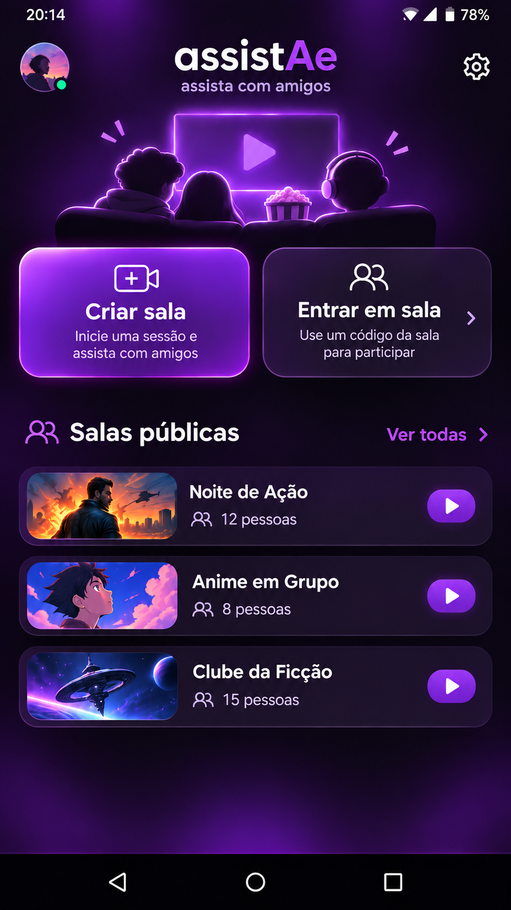

# assistAe

## Primeiro APK de teste — 11/11/2026

Aplicativo Android nativo com Home, salas, chat, fila, player e amigos ligados ao Supabase. O APK usa assinatura de teste e instalação direta. A primeira abertura mostra o identificador da instalação para liberação no beta. As notificações estão implementadas e aguardam configuração de envio e teste no aparelho. [Build e instalação](android/README.md) · [Estado e evidências](docs/IMPLEMENTACAO.md)

## Avanço de implementação e aparelho — 09/11/2026

Backend possui 16 migrações, 23 tabelas privadas e 30 RPCs: identidade/preferências, salas/catálogo, leases/reconexão, chat/administração, amizade/convites e status de comandos. Dezessete suítes SQL passaram. Aceite explícito nas cruzadas, remoção bilateral preservando convites emitidos, outbox sem envio push. Papéis de API limitados, sem login/BYPASSRLS/DDL permanente. Locks de perfis UUID antes de par/sala/FKs; disputa entre duas sessões ainda não demonstrada. [Estado, decisões técnicas e evidências](docs/IMPLEMENTACAO.md). Pendentes mídia/fila, dispatcher push, Realtime e app Android/APK; Auth/REST e aparelho não validados. P01–P15/design preservados, B00/blocos completos não concluídos. Galaxy A54 com Play Store confirmado, APK direto, somente Android; versões exatas do SO não informadas. Sem imagem nova, publicação de APK ou notificações reais enviadas. Notas abaixo são históricas.

## Implementação iniciada — 09/11/2026

A pedido do usuário, começou a implementação pelo Supabase. O projeto existente **assistae** recebeu 23 tabelas privadas e seis RPCs de identidade/preferências. Cinco suítes SQL foram executadas com rollback; operações de sala/player/chat/social e Android/APK ainda não implementadas. Veja [estado e evidências](docs/IMPLEMENTACAO.md) e [guia do banco](supabase/README.md). As restrições de somente planejamento abaixo descrevem a etapa anterior; não declarar o app ou backend completos.

**Planejamento em 09/11/2026:** escolhas de comportamento P01–P15 confirmadas em [DECISOES.md](docs/DECISOES.md). Próxima etapa: fechar revisão técnica e operação de B00 em [BLOCOS.md](docs/BLOCOS.md). Não há app/backend/APK implementado ou testado; respostas não autorizam programação.

**Correção de escopo — 08/11/2026:** usuário pediu planejar integralmente banco, métodos, algoritmos, segurança, contratos, operação e testes antes do desenvolvimento. Não iniciar código, projeto Android, migrações executáveis ou provisionamento por consequência deste planejamento. O design existente continua como base e ajustes reutilizam os mesmos cards. A proposta técnica inicial está em [docs/ARQUITETURA.md](docs/ARQUITETURA.md). Ainda há decisões abertas; não declarar planejamento concluído ou aprovado. Implementação somente após solicitação posterior do usuário. Esta correção prevalece sobre referências anteriores a construir a base/navegação como próximo passo. Nesta revisão: somente documentação, sem imagens, publicação, implementação ou testes funcionais.

**Etapa atual — 08/11/2026:** usuário liberou o design para avançar ao planejamento do desenvolvimento. Ajustes devem reutilizar os mesmos modelos de cards. Veja o [Plano de desenvolvimento](docs/DESENVOLVIMENTO.md). Nenhum app/backend/APK implementado ou testado. Pendências visuais históricas abaixo não bloqueiam esta etapa.

Aplicativo nativo Android para assistir a vídeos com amigos em salas públicas ou privadas, com player sincronizado e chat.

**Estado em 08/11/2026:** telas principais 01 a 07 com design aprovado. Sistema de amizade e convites internos confirmado no planejamento. Painéis e estados complementares ainda pendentes. Ainda não há aplicativo implementado nem APK validado.

**Revisão de decisões em 08/11/2026:** sala pública por padrão; amizade por código único com solicitação/aceite e sem login ou recuperação; novo botão Amigos em Configurações, com ajuste visual pendente. Convites válidos até uso ou encerramento da sala. Mensagens horizontais começam embaixo e passam uma por vez, por ordem de chegada ao servidor. Demais decisões registradas no planejamento; nenhuma nova imagem ou implementação nesta revisão.

## Comece aqui

- [Revisão de consistência](docs/CONSISTENCIA.md): achados e conciliação documental entre banco, contratos e estados; pendências técnicas ainda abertas.
- [Desenvolvimento em blocos](docs/BLOCOS.md): roteiro B00–B09 com dependências, entregas e critérios de aceite. Etapa atual: fechamento do planejamento, sem implementação.
- [Decisões e fechamento do planejamento](docs/DECISOES.md): registro único do que já foi confirmado e do que falta resolver.
- [Segurança e matriz de testes](docs/SEGURANCA-TESTES.md): permissões propostas e critérios de aceite; testes ainda não executados.
- [Arquitetura Android e infraestrutura](docs/ANDROID-INFRA.md): organização do app, player, notificações, backend e operação propostos.
- [Parâmetros e teste fechado](docs/PARAMETROS.md): recomendações numéricas e decisões de cache/notificações de 09/11/2026.
- [Estados e algoritmos](docs/ALGORITMOS.md): proposta de reconexão, sucessão, sincronização, fila e tratamento de falhas.
- [Contratos dos métodos](docs/CONTRATOS.md): proposta de entradas, permissões, respostas, falhas e concorrência.
- [Planejamento técnico do banco](docs/BANCO.md): proposta v1 e decisões confirmadas de reconexão/participação.
- [Planejamento completo](docs/PLANEJAMENTO.md)
- [Telas aprovadas e pendentes](docs/DESIGN.md)
- [Ponto de continuidade para outro modelo](docs/CONTINUIDADE.md)
- [Instruções para agentes](AGENTS.md)

## Home aprovada

A imagem original foi fornecida pelo usuário e seu envio foi autorizado. É uma referência de design, não uma captura de um aplicativo implementado. As divergências entre os exemplos da imagem e as regras funcionais estão registradas em [DESIGN.md](docs/DESIGN.md).

## Outras telas aprovadas

- [Criar sala](docs/design/criar-sala-aprovada.png): nome e interruptor de sala pública/privada.
- [Entrar em sala](docs/design/entrar-sala-aprovada.png): código e convites de amigos.
- [Player vertical](docs/design/player-vertical-aprovado.png): vídeo com chat; participantes pelo contador e Fila/Compartilhar nos três pontos.
- [Player horizontal](docs/design/player-horizontal-aprovado.png): imersivo, com mensagens pequenas passando da esquerda para a direita; tamanho visual aprovado como padrão e ajustes de posição, tamanho e velocidade previstos.
- [Configurações](docs/design/configuracoes-aprovada.png): Mudar apelido, Configuração de mensagem, Notificações e Sobre o app.
- [Salas públicas](docs/design/salas-publicas-aprovada.png): busca por nome e entrada pelo card; miniatura definitiva ainda pendente.

As referências foram aprovadas e seu envio ao GitHub foi autorizado pelo usuário. São modelos estáticos de design, não capturas de aplicativo implementado.

**Painéis aprovados:** [Fila](docs/design/propostas/fila-proposta-v1.png), [Adicionar vídeo](docs/design/propostas/adicionar-video-proposta-v1.png) e [Participantes](docs/design/propostas/participantes-proposta-v1.png), com envio das três referências ao GitHub autorizado. Sem implementação/testes.

**Também aprovados:** [Compartilhar/Convidar](docs/design/propostas/compartilhar-proposta-v1.png), [Chat horizontal aberto](docs/design/propostas/chat-horizontal-proposta-v1.png) e [Amigos](docs/design/propostas/amigos-proposta-v1.png), com envio dessas três referências ao GitHub autorizado. Sem implementação/testes.

**Painéis de Configurações aprovados:** [Mudar apelido](docs/design/propostas/mudar-apelido-proposta-v1.png), [Configuração de mensagem](docs/design/propostas/configuracao-mensagem-proposta-v1.png), [Notificações](docs/design/propostas/notificacoes-proposta-v2.png) e [Sobre o app](docs/design/propostas/sobre-app-proposta-v1.png). Envio autorizado pelo usuário. Notificações usa salvamento automático ao alterar os interruptores, sem botão de salvar.

**Estados e confirmações aprovados:** [Sala sem vídeo](docs/design/propostas/sala-sem-video-proposta-v1.png), [Fim da fila](docs/design/propostas/fim-fila-proposta-v1.png), [Menu da sala](docs/design/propostas/menu-sala-proposta-v1.png), [Encerramento](docs/design/propostas/confirmar-encerrar-proposta-v1.png), [Expulsão](docs/design/propostas/confirmar-expulsar-proposta-v1.png) e [Transferência](docs/design/propostas/confirmar-transferir-proposta-v1.png). Envio dessas seis referências autorizado; somente a versão final corrigida da transferência foi selecionada.

**Erros e vazios aprovados:** [Código inválido](docs/design/propostas/erro-codigo-proposta-v1.png), [Sala lotada](docs/design/propostas/sala-lotada-proposta-v1.png), [Sala encerrada](docs/design/propostas/sala-encerrada-proposta-v1.png), [Vídeo inválido](docs/design/propostas/video-invalido-proposta-v1.png), [Reconectando](docs/design/propostas/reconectando-proposta-v1.png), [Sem salas](docs/design/propostas/sem-salas-proposta-v1.png), [Sem resultados](docs/design/propostas/sem-resultados-proposta-v1.png), [Sem amigos](docs/design/propostas/sem-amigos-proposta-v1.png) e [Sem convites](docs/design/propostas/sem-convites-proposta-v1.png). Envio destas nove referências autorizado pelo usuário.

**Design ainda não integralmente concluído:** faltam Configurações com Amigos, solicitações enviadas com itens, saída com sucessor, variantes sem permissão e carregamentos/feedbacks/validações restantes. Prévia com teclado dispensada pelo usuário; validação Android futura. Miniatura definitiva adiada e parâmetros pendentes. Nenhum aplicativo/backend/APK implementado ou testado. Novas imagens exigem autorização específica de envio ao GitHub.
