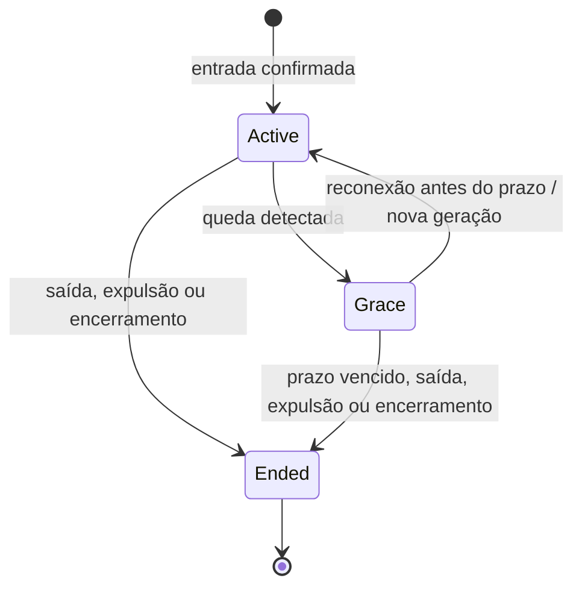

# Estados e algoritmos — proposta v1

Revisão cruzada de 09/11/2026 em [CONSISTENCIA.md](CONSISTENCIA.md). Campos e transições conciliados com BANCO/CONTRATOS como proposta técnica, sem implementação/testes ou aprovação integral. P01–P15 preservados.

P04–P06 confirmados em 09/11/2026: suspensão pelo Android quando pausado/sem vídeo segue reconexão normal, com reserva de 60 s após detecção; número visível nos cards e sala conta somente conectados, mas reservas válidas ainda ocupam o limite de 10; ex-administrador preserva apenas sua permissão individual anterior, sem ganhar controle automaticamente ao transferir. Áudio durante reprodução em segundo plano permanece requisito. Esta atualização substitui pendências históricas desses comportamentos. Nenhuma imagem, implementação, publicação ou teste.

Confirmado em 09/11/2026 (P01–P03 de DECISOES.md): reserva de 60 segundos contada após detectar a queda; Play com sala ainda sem mídia inicia o primeiro item da fila, mas adicionar sozinho não inicia; fonte reproduzível com duração inconclusiva é permitida, com avanço manual por administrador/participante autorizado ao terminar. Essa última regra é exceção explícita ao avanço automático, não permissão a usuário comum. Detecção/limites técnicos e apresentação da ação manual ainda precisam de especificação. Substitui pendências históricas desses três pontos abaixo. Somente planejamento, sem implementação/testes.

Atualização de 09/11/2026: usuário confirmou manter as mensagens já vistas antes da queda, sem recuperar o intervalo desconectado; notificações de convites/solicitações também com app fechado; uso inicial em teste fechado com amigos. P11 confirmou cache somente em memória, perdido após morte do processo; fornecedor de push continua aberto. P15 confirmou limites de uso em [PARAMETROS.md](PARAMETROS.md); demais parâmetros de engenharia, retenção e capacidade de infraestrutura continuam propostos e não testados. Nenhuma implementação, infraestrutura, imagem ou publicação.

Decisões confirmadas pelo usuário em 08/11/2026: (1) se o administrador sair e os demais estiverem reconectando, preservar reservas e manter sala temporariamente sem administrador, atribuindo o papel quando alguém retornar; (2) Play após terminar o último vídeo recomeça esse vídeo; (3) pular animações antigas excedentes, mantendo mensagens no chat autorizado. P15 confirmou depois até 5 animações pendentes e pular espera maior que 20 s, sem apagar chat/descartar corrente repetida por rotação. Isso não permite recuperar mensagens do intervalo desconectado nem aprova integralmente os mecanismos técnicos. Nenhuma imagem, implementação, publicação ou teste. Esta atualização substitui pendências históricas desses três comportamentos abaixo.

08/11/2026. Planejamento, sem implementação ou teste. Complementa BANCO.md e CONTRATOS.md. As soluções e parâmetros aqui recomendados não são novas aprovações do usuário. Onde uma recomendação afeta experiência, está marcada como decisão pendente.

## 1. Garantias que todos os fluxos preservam

Uma identidade ocupa no máximo uma sala. Sala admite no máximo 10 vagas incluindo reservas; número visível conta só conectados (P05). Reserva dura 60 segundos após detectar a queda (P01). Reconexão mantém mensagens já vistas localmente, sem recuperar intervalo desconectado. Somente administrador/participante autorizado altera reprodução e fila. Uma conclusão de mídia avança no máximo um item. Sala encerrada não reabre por retry, heartbeat ou convite antigo.

Ponto de decisão de uma ação é a transação autorizada no servidor. O cliente apresenta intenção e estado local; eventos não substituem a leitura autorizada. Todos os relógios, cursores, ids e flags enviados pelo cliente são tratados como dados não confiáveis.

## 2. Participação, detecção de queda e prazo

Ended é terminal para essa participação. Entrada posterior, se permitida, cria outra participação e outro join_order. Active/grace não devem depender apenas de um campo possivelmente atrasado: operações calculam validade pelos prazos sob lock.

Fase efetiva: ended se participação terminal ou sala closed; expirada se agora >= grace_deadline; grace se detected_at não nulo ou agora >= suspect_at; active caso contrário. Por silêncio, materializar detected_at=suspect_at e detection_source=silence mesmo com worker atrasado. Sinal confiável da geração atual antes de suspect_at registra o instante observado no servidor e deadline=detected_at+60 s. Após primeira detecção, nenhum heartbeat/sinal estende prazo; reconexão válida estabelece nova geração. Gates usam a fase efetiva sem esperar worker. Nomes canônicos: detected_at e generation.

**P01 confirmado:** contar 60 segundos após detectar a queda. Proposta técnica: H = intervalo de heartbeat; D = silêncio que caracteriza queda; S = atraso-alvo da rotina. Após heartbeat aceito em t, suspect_at=t+D e grace_deadline=suspect_at+60s. Um sinal confiável de transporte pode antecipar detecção sem prolongar prazo iniciado. Não confiar no horário alegado pelo aparelho. H/D/S e integração do transporte continuam técnicos a especificar.

O prazo começa na detecção, não na queda física. No cenário de silêncio, o limite pode ocorrer até aproximadamente D+60 s após a queda, com materialização posterior pelo worker; operações revalidam o prazo sem conceder extensão por atraso da rotina. last_seen+60s não representa a regra confirmada. H/D/S e scheduler permanecem abertos; não prometer precisão sem evidência.

Algoritmo de heartbeat:

1. Validar ator e geração, bloquear sala/participação e reler estado.
2. Se terminal ou agora ≥ grace_deadline, não renovar; reconciliar expiração.
3. Se fase efetiva grace, materializar detecção e retornar RECONNECT_REQUIRED; heartbeat comum não restabelece acesso nem abre janela.
4. Se heartbeat_seq ≤ last_heartbeat_seq, retornar confirmação anterior sem estender prazo.
5. Caso válido, atualizar last_seen, sequência e prazos relativos ao heartbeat atual. Limitar frequência para não transformar batimentos em escrita ilimitada.

No cliente, qualquer interrupção reconhecida do canal de dados inicia reconexão formal antes de consultar chat, mesmo se heartbeat ainda parece saudável. O servidor não pode detectar toda interrupção física imperceptível: a fronteira observável é handshake de reconexão/timeout, não uma garantia de identificar cada milissegundo offline.

## 3. Reconexão e mensagens novas

Estados locais: connected → reconnecting → connected ou participation_ended. Enquanto reconnecting, bloquear envio de chat/comandos compartilhados; reprodução local pode seguir o último estado, sem afirmar que ainda está sincronizada.

Algoritmo de reconexão:

1. Renovar credencial, se necessário, sem criar identidade nova.
2. Enviar mesmo request_id nas repetições e expected_generation da conexão anterior.
3. Sob lock, conferir sala, identidade, participação, geração e prazo. Em agora = deadline, tratar como vencido (proposta de fronteira determinística).
4. Incrementar generation, zerar last_heartbeat_seq, definir last_seen_at=agora/suspect_at=agora+D/grace_deadline=suspect_at+60 s, limpar detected_at/detection_source; fechar janela anterior e abrir nova após last_message_seq sob mesmo lock. Preservar join_order/vaga. Reconexão formal também pode ocorrer antes de suspect_at após interrupção observada no cliente; sempre invalida geração antiga.
5. Confirmar transação e devolver geração/janela. Retry confirmado devolve as mesmas, não abre janela adicional.
6. Inscrever canal da geração vigente e obter snapshot/leitura de mensagens após o novo limite. Bufferizar avisos enquanto lê; aplicar apenas revisões atuais.
7. Descartar callbacks, respostas e mensagens da geração antiga; realinhar player.

Mensagens enviadas entre o commit da reconexão e a inscrição podem ser lidas pela janela nova: não pertencem ao intervalo desconectado definido pelo servidor. Nenhum cursor pode retroceder esse limite. Manter localmente o que já estava visível antes da queda, conforme confirmado, sem leitura retroativa no servidor. P11 define cache somente em memória, perdido após morte do processo; não reabrir janelas antigas para reconstruí-lo.

## 4. Sucessão e sala temporariamente sem administrador

Estados propostos de administração, separados do status active/closed da sala: assigned, awaiting_successor e none (este somente em closed). O segundo é recuperação interna, não sala de espera nem tela nova.

| Gatilho | Regra de transição |
|---|---|
| Transferência manual | Revalidar alvo conectado e revisão; trocar admin na mesma transação; quem transfere continua membro |
| Admin sai com alvo escolhido | Se alvo não é mais elegível, conflito sem saída parcial; usuário pode escolher novamente ou omitir escolha |
| Admin sai sem escolha | Eleger participante conectado com menor join_order; empate por id |
| Admin cai | Preservar administração até prazo; reconexão válida mantém papel |
| Prazo do admin vence | Encerrar participação e eleger mais antigo conectado, se houver |
| Admin sai/expira, só restam reservas | Proposta: admin nulo, awaiting_successor, manter reservas sem renová-las |
| Primeiro reservado retorna nesse estado | Proposta: após admitir reconexão, eleger o menor join_order entre os conectados naquele commit |
| Nova entrada nesse estado | Proposta: admitir normalmente se houver vaga e elegê-la caso seja único conectado; não dar preferência a pessoa ainda offline |
| Nenhuma participação/reserva válida resta | Encerrar sala |

**Decisão confirmada em 08/11/2026:** preservar as reservas e manter a sala temporariamente sem administrador quando ele sair e todos os demais estiverem reconectando; atribuir o papel quando alguém retornar. O modelo passa a permitir administrador nulo nesse estado. Nomes internos, eleição concorrente e tratamento de novas entradas continuam propostas técnicas; a resposta não aprova automaticamente todas essas variantes.

Se duas pessoas retornam simultaneamente, transações serializadas definem a primeira eleição; chegada posterior mais antiga não destitui o admin recém-eleito. “Mais antigo” significa menor join_order entre elegíveis no instante da eleição, não previsão de quem ainda retornará. Se todos estão em grace, ninguém envia comandos; reprodução global não pausa automaticamente por esse motivo.

Última saída voluntária encerra imediatamente quando não há outras participações/reservas válidas. Se há outras reservas, o que saiu não era o último participante reservado. Não estender deadline de terceiros pela saída do admin. Ex-admin não recupera administração ao reentrar após prazo expirado.

## 5. Worker de prazos e concorrência

Consultar candidatos por deadline; processar salas em lotes limitados, com ordem estável de locks. Cada sala é reconciliada em transação curta: reler deadlines e gerações → expirar vencidos → escolher administrador se necessário → encerrar se vazia → incrementar revisões pertinentes → commit. Candidato obtido antes do lock não prova expiração; reconexão pode ter vencido a disputa.

Operações de usuário também reconciliam prazos da sala para que worker atrasado não conceda direitos vencidos. No empate, a ordem dos commits e a checagem de deadline decidem; um lock obtido depois do prazo não usa horário de início da requisição para ressuscitar vaga.

Não segurar lock ao enviar evento, fazer push ou consultar mídia. Deadlock/erro transitório com rollback permite retry da transação com o mesmo pedido; conflito de versão exige nova leitura e intenção explícita. Medir atraso do worker separadamente do prazo funcional. Processo no celular e temporizador de UI não são responsáveis por encerrar sala no servidor.

## 6. Estado compartilhado e estado local do player

Compartilhado: empty, paused, playing, ended. Local: preparing, ready, buffering, failed, suspended_by_audio_focus e stopped_locally (P13). stopped_locally não altera sala/player compartilhado; retomada explícita revalida estado e reconecta/realinha quando necessário. Estado local não vira pausa/falha compartilhada automaticamente.

| Estado/ação | Resultado compartilhado proposto |
|---|---|
| empty + adicionar à fila | Continua empty; não começa sozinho |
| empty + play autorizado com fila | Novo método startQueue promove primeiro item, posição zero, playing, novo epoch |
| empty + play sem fila | INVALID_INPUT/estado sem mídia, sem alteração |
| Qualquer + playNow autorizado | Nova mídia, posição zero, playing, novo epoch; atual interrompida não entra na fila |
| playing + pause | Materializar posição e entrar paused |
| paused + play | Manter posição e atualizar referência, entrar playing |
| playing/paused + seek | Nova posição, conservar estado de play/pausa e incrementar revisão |
| playing + término validado + fila | Promover próximo automaticamente, novo epoch, playing |
| playing + término validado sem fila | ended, última mídia/quadro preservados |
| playing + avanço manual autorizado em modo inconclusivo | Promover um próximo com nova epoch/playing ou ended na última mídia; nunca automático por relato comum |
| playing + play / paused + pause | unchanged, sem nova revisão/epoch |
| seek fora de playing/paused ou pause em ended | INVALID_INPUT sem alteração; replay de ended usa play |
| sala closed | playback empty, media_id=null, posição zero; epoch/revisão incrementadas; rejeitar replay e demais comandos |
| ended + play | Aprovado: reiniciar último vídeo do zero; novo epoch é mecanismo técnico proposto para rejeitar términos antigos |

P02 confirmou que o Play inicial promove o primeiro item, sem início ao adicionar. startQueue é o contrato técnico proposto, com expected_playback_revision e expected_queue_revision. Usar controle existente. Play em ended recomeça o último vídeo, também confirmado. Nomes de métodos e erros continuam especificação técnica.

media_epoch identifica uma execução da mídia, inclusive replay do mesmo URL. Assim um término antigo não encerra um replay. playback_revision muda em comandos; queue_revision muda em alterações de fila. Todas as mutações conferem permissão no momento da execução.

## 7. Relógio e correção de sincronização

Estado base: posição p0, horário do servidor t0, playing/paused, epoch/revisão. Posição-alvo = p0 quando pausado; quando tocando, p0 + (tempo estimado do servidor − t0), limitada a zero/duração validada. Não somar tempo de rede novamente se ele já está incluído na estimativa do relógio.

Recomendação: amostrar ida/volta com timestamps de recepção/envio do servidor e relógio monotônico do cliente. Estimar offset pelo ponto médio, descontar processamento do servidor quando conhecido, rejeitar amostras lentas/atípicas e combinar um pequeno conjunto das de menor RTT. Rede assimétrica deixa erro residual. Relógio civil do aparelho não governa player nem deadlines; detectar salto do relógio do servidor e pedir novo snapshot/estimativa em vez de aplicar seek enorme automaticamente.

Controle por faixas com histerese:

- |erro| ≤ E_small: manter velocidade normal.
- E_small < |erro| < E_seek: ajustar temporariamente playback speed em faixa limitada, se suportado; à frente desacelera, atrás acelera.
- |erro| ≥ E_seek ou epoch mudou: seek/preparação na posição-alvo atualizada.
- Durante buffering/preparing/suspensão de áudio: não perseguir erro a cada frame; ao recuperar, recalcular alvo e corrigir.
- Pausado: corrigir posição se necessário, sem usar velocidade ou iniciar reprodução.

Usar cooldown entre correções e limiar de saída menor que entrada para evitar oscilação. Não fazer seek contínuo em mídia sem suporte adequado. E_small/E_seek, limites de speed, frequência de amostragem e cooldown são parâmetros técnicos a medir, ainda não aprovados ou testados. Protocolo deve expor qualidade da estimativa para distinguir atraso real de incerteza de relógio.

## 8. Término de mídia: autoridade e limitações

Fluxo de validação conciliado: validateMedia cria media_validations pending e retorna validation_id; getMediaValidation consulta estado do próprio ator/sala/participação. Resultado valid ou inconclusive admitido e não vencido é referência obrigatória em addToQueue/playNow. Copiar confiança/duração/proveniência para media_items; ticket expirado não autoriza nova admissão. API deriva termination_mode a partir desse snapshot; expected_end_at só em playing/server_timeline e nunca é verdade independente persistida. Análise de rede ocorre fora dos locks. Executor, vinculação à versão real de fonte mutável e limites ainda T03/T04/T07.

**Recomendação técnica:** timeline autoritativa no servidor, com duração obtida de validação confiável de VOD. MP4/HLS continuam sendo reproduzidos diretamente por cada aparelho; analisar metadados não significa retransmitir vídeo. Validador e custo ainda não escolhidos.

Planejar validação fora da transação: resolver fonte permitida → limitar redirects/bytes/tempo → analisar metadados MP4 ou playlist HLS VOD → verificar formato, finitude e duração → registrar origem/validade da avaliação. Proteger qualquer acesso servidor contra SSRF e redes privadas, inclusive redirects/DNS; isto exige desenho de infraestrutura específico antes de implementar. URL mutável pode trocar conteúdo após validação: vincular metadados a versão/validator da fonte quando possível e tratar divergência como fonte não confirmada, não confiar indefinidamente no URL.

Toda rotina de player primeiro revalida sala active e reconcilia prazos; closed nunca avança/reproduz. Sala temporariamente sem conectado mas com reservas válidas não pausa só por esse motivo.

Ao entrar playing com duração confiável, calcular expected_end_at a partir da posição/referência. Ao pausar/buscar/trocar, a revisão muda e invalida o agendamento anterior. Worker de término ou aviso de cliente apenas dispara verificação: sob lock, reler epoch/revisão/status/posição-alvo/duração. Se playing e alvo ≥ duração, avançar uma vez e confirmar novo estado. Em processamento atrasado, começar o próximo no commit atual, sem pular vários vídeos para “compensar” downtime.

P03 confirmou permitir fonte reproduzível inconclusiva e exigir avanço manual por administrador/participante autorizado ao terminar. Não usar consenso de aparelhos ou relato comum como prova confiável. advanceAfterUnverifiedEnd revalida CONTROL, modo de término, epoch/revisões e recibo; promove um próximo ou marca ended na última mídia. Fonte inválida/fora de VOD continua rejeitada. Executor, proveniência e validade da avaliação seguem trabalho técnico aberto.

Critério autoritativo usa o tempo compartilhado, não prova que cada aparelho terminou de assistir; buffering individual não interrompe os outros, conforme regra aprovada. Aviso de cliente não autorizado nunca vira permissão para trocar mídia. Metadata validada também não garante fonte disponível para todos na hora da reprodução.

## 9. Fila e comandos concorrentes

P09 permite repetir URL em itens independentes por adição intencional; retry do mesmo pedido não cria outro item. P15 limita a fila a 50 próximos vídeos, sem contar a mídia atual. Fila limitada: posições inteiras contíguas e renumeração O(n), simples de auditar. Sob lock da sala, conferir queue_revision e conjunto completo dos ids antes de reorder; adicionar/remover concorrente produz conflito, não desaparecimento silencioso de item. Unicidade de posição é diferida até commit, conforme proposta do banco.

Avanço: conferir estado/epoch → remover primeiro item → promover mídia → renumerar restantes → atualizar revisões → commit. Cada etapa faz parte da mesma transação. Falha antes de commit deixa fila/player anteriores intactos. Vários avisos de fim chegam à mesma transição; apenas a primeira satisfaz epoch/status/revisão.

Comandos play/pause/seek não usam last-write-wins cego. Duas intenções com a mesma revisão: a primeira válida confirma, a outra recebe conflito. Interface não reenvia automaticamente seek antigo com revisão nova. Retry do mesmo request_id consulta recibo antes de interpretar revisão antiga como conflito.

## 10. Chat e sobreposição horizontal

No servidor, sendMessage bloqueia primeiro perfil do ator e depois sala/contador, na ordem de BANCO. Abertura de janela compartilha o lock/contador da sala: P08 exige capturar apelido do perfil no commit do envio, preservando-o nas mensagens antigas. A sequência representa ordem de aceitação transacional, não timestamp do celular nem ordem física exata de chegada dos pacotes na rede. Mensagens simultâneas são ordenadas pelo servidor; UI só usa essa sequência.

No cliente, obter mensagens por cursor dentro da janela, deduplicar por (room_id,seq) e enfileirar em ordem crescente. Eventos são aviso para leitura, não atalho que ignora janela. Lista completa e sobreposição têm consumidores separados: fechar painel não apaga chat nem interrompe vídeo. Sobreposição FIFO apresenta uma por vez, esquerda → direita, inicialmente embaixo.

**Decisão confirmada em 08/11/2026:** pular animações antigas excedentes quando chegam mais mensagens do que a sobreposição consegue mostrar, preservando as mensagens no chat autorizado. Descartar somente itens pendentes da animação, não registros do chat; conservar a ordem de sequência dos restantes e uma animação por vez. P15 confirmou até 5 animações pendentes e pular as que esperarem mais de 20 s; não remover chat nem descartar animação em curso repetida por rotação. Tamanho/velocidade numéricos permanecem abertos. P12: usar reticências só na animação; chat mantém texto inteiro. Ao girar, repetir do início a animação interrompida antes das próximas em ordem. Proposta técnica: coordenador mantém item corrente e fila em memória, UI reanexa sem novo envio/registro; se sair do horizontal, guardar corrente para retorno enquanto a mesma participação/processo continuar válida. Não repetir animações concluídas nem restaurar geração invalidada. Ao reconectar, cancelar animações pendentes da geração antiga é proposta técnica; manter já vistas no chat local está confirmado; P11 define perda do cache após morte do processo. Preservação no chat não autoriza recuperar mensagens do intervalo desconectado.

## 11. Retry, expiração de pedidos e antispam

Proposta conciliada contra reexecução: command_contexts persistido, com actor_id/id/issued_at/expires_at/contract_version/revoked_at. Envelope usa command_context_id/request_id. Sem recibo, contexto inexistente/vencido/revogado rejeita nova execução; recibo existente pode retornar resultado mínimo mesmo após expiração, sem restaurar acesso. Reter recibos até fim da validade do contexto mais margem. Não migrar pedido antigo para novo contexto. ensureProfile convergente/emissão de contexto/heartbeat têm as exceções de CONTRATOS §1. TTL/margem e ponto de decisão da revogação ainda T05/T07/T08; contexto não substitui LIVE/CONTROL.

Na expiração, consultar resultado/estado; não portar pedido antigo para contexto novo automaticamente. Repetição voluntária é nova intenção, avaliada contra estado atual. Contexto pode ser obtido junto ao perfil/admissão para evitar uma chamada por clique. Bootstrap de perfil é operação convergente pela chave da identidade, sem depender de perfil já existente.

Backoff proposto: esperar número aleatório uniforme entre zero e min(cap,base×2^tentativa), respeitando retry_after mínimo do servidor; parar por prazo/contexto vencido, erro permanente, cancelamento ou nova intenção. Acordar por mudança de rede não deve gerar vários loops concorrentes. base/cap/orçamento de tentativas pendentes.

Antispam token bucket: sob atualização atômica, recompor tokens até capacidade C usando tempo decorrido e taxa r; se custo disponível, descontar; caso contrário devolver espera mínima. Capacidade/taxa/custo por operação ainda por definir. Separar identidade/operação e proteção do serviço contra criação massiva de identidades; limite por usuário não basta contra reinstalação. Retry já confirmado não gasta novamente cota funcional; tentativas HTTP ainda podem ter proteção de borda.

## 12. Amizade, convites e outbox

Par canônico serializa solicitações cruzadas, aceite e remoção. Estados: pending → accepted/rejected/cancelled. P07 confirmou: cruzada exige aceite explícito; remetente pode cancelar enquanto pending; qualquer envolvido remove vínculo bilateral com confirmação. Retry não repete efeito nem recria amizade. Limites de reenvio/novas solicitações permanecem a detalhar sem alterar essas regras.

Convite: pending → used somente junto à entrada confirmada; pending → room_closed no encerramento. Não consumir por clique, sala lotada ou ALREADY_IN_ROOM. Remoção de amizade não invalida silenciosamente convite já emitido, respeitando validade aprovada até uso/encerramento.

Outbox proposta: pending → leased → delivered; falha transitória retorna pending com next_attempt_at; falha permanente → failed; evento não mais válido → suppressed. Worker reivindica lote com lease e attempt_token, confirma claim, envia fora da transação e grava resultado somente se status ainda é leased e token ainda é seu. delivered/failed/suppressed limpam claim; supressão invalida token e conclusão atrasada não a sobrescreve. Lease expirado pode gerar tentativa duplicada; usar event_key/idempotência do provedor quando disponível e deduplicação no receptor. Não prometer entrega exatamente uma vez. Estado do convite pode mudar entre verificação e push: aviso abre consulta ao estado atual, nunca concede entrada por si só.

## 13. Segurança de estado e publicação

Revogação autoritativa ocorre na transação, não quando evento chega ao celular. Todas as leituras e comandos revalidam participação/geração/janela. Cliente offline pode continuar exibindo bytes já recebidos; não prometer apagamento remoto instantâneo. Fechamento limpa chat no banco ativo e invalida novas leituras; backups têm política separada.

Eventos carregam mínimo necessário e podem atrasar/duplicar/perder-se. Usar aviso de revisão → leitura autorizada → comparação; não expor corpo/URL em canal antigo. Rotina de reconciliação periódica enquanto ativo deve ter intervalo escolhido pelo orçamento/latência. Se entrega durável de aviso se tornar requisito, planejar outbox específica de eventos; não reaproveitar ingenuamente notificações sociais.

## 14. Alterações propostas para banco e contratos

| Local | Refinamento proposto |
|---|---|
| rooms | admin_state assigned/awaiting_successor; admin nullable no segundo caso ou closed. Preservar reservas na saída do admin está confirmado; eleição concorrente/novos entrantes ainda técnicos |
| connections | Incorporados suspect_at/detected_at/detection_source e generation; grace não renova por heartbeat. Campos/semântica em BANCO §3 |
| playback/media | Incorporados media_validations e snapshot em media_items; termination_mode/expected_end_at derivados, sem armazenamento duplicado. Executor/fonte mutável ainda abertos |
| API de fila/player | startQueue com revisões de fila e reprodução; replay em ended requer nova epoch |
| Comandos | command_contexts persistido, envelope command_context_id e recibos vinculados; TTL/revogação/limpeza ainda pendentes |
| notification_outbox | lease_until, attempt_token e estados de claim/entrega/supressão |

Refinamentos incorporados ao desenho dos três documentos, sem migrações ou implementação. Regras de produto confirmadas permanecem distintas de propostas técnicas. Modelos anteriores continuam referência histórica quando conflitarem com estas propostas; nenhuma condição de produto foi aprovada apenas pela documentação.

## 15. Cenários de verificação futura

| Cenário | Resultado exigido/proposto |
|---|---|
| Heartbeat antigo após nova geração | Ignorado, sem estender prazo ou reabrir chat |
| Reconexão exatamente no deadline | Expira pela fronteira proposta; entrada nova se permitida |
| Worker lê vencido, heartbeat válido confirma antes do lock | Worker relê e não expira registro atualizado |
| Dois sucessores retornam juntos | Uma eleição serializada, sem dois admins |
| Admin sai, outros só em grace | awaiting_successor proposto, sem cancelar reservas |
| Pause disputa timer de fim | Lock/revisão/status determinam única transição válida |
| Replay recebe fim de epoch anterior | Nenhum avanço |
| Worker de fim atrasou dois minutos | Inicia só próximo item no commit, não pula fila |
| Chat 10–20 chegou offline | Janela nova começa após 20; cursor adulterado não recupera 10–20 |
| Retry após recibo limpo | Contexto vencido impede nova execução |
| Worker de push cai depois do envio | Retry pode duplicar; event_key deduplica quando suportado |
| Fonte muda depois da validação | Não alegar duração/conteúdo ainda confiável sem revalidação |

Nenhum cenário executado. Próximo planejamento: revisar escolhas de produto pendentes e consolidar parâmetros/infraestrutura, arquitetura Android e critérios quantitativos de validação. Não iniciar desenvolvimento.
