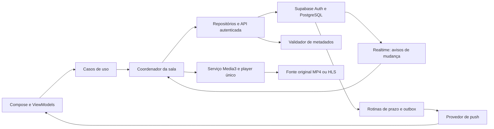

# Arquitetura Android e infraestrutura — proposta v1

P04–P06 confirmados em 09/11/2026: suspensão pelo Android quando pausado/sem vídeo segue reconexão normal, com reserva de 60 s após detecção; número visível nos cards e sala conta somente conectados, mas reservas válidas ainda ocupam o limite de 10; ex-administrador preserva apenas sua permissão individual anterior, sem ganhar controle automaticamente ao transferir. Áudio durante reprodução em segundo plano permanece requisito. Esta atualização substitui pendências históricas desses comportamentos. Nenhuma imagem, implementação, publicação ou teste.

Confirmado em 09/11/2026 (P01–P03 de DECISOES.md): reserva de 60 segundos contada após detectar a queda; Play com sala ainda sem mídia inicia o primeiro item da fila, mas adicionar sozinho não inicia; fonte reproduzível com duração inconclusiva é permitida, com avanço manual por administrador/participante autorizado ao terminar. Essa última regra é exceção explícita ao avanço automático, não permissão a usuário comum. Detecção/limites técnicos e apresentação da ação manual ainda precisam de especificação. Substitui pendências históricas desses três pontos abaixo. Somente planejamento, sem implementação/testes.

09/11/2026. Planejamento para teste fechado entre amigos. Nenhum projeto, serviço, conta, migração, APK ou teste criado/executado. Stack de produto aprovada: Kotlin, Compose, Media3 e Supabase. Componentes e fornecedores adicionais abaixo são recomendações técnicas, não aprovações implícitas.

## 1. Visão de responsabilidades

Banco decide permissões e estado compartilhado. Coordenador mantém estado local coerente e aplica snapshots. Player acessa fonte diretamente. Validador lê metadados com orçamento controlado e não retransmite vídeo. Push avisa sobre recursos existentes, nunca concede entrada ou controla reprodução.

## 2. Organização Android recomendada

Começar com um módulo de aplicativo e pacotes com fronteiras claras; separar módulos Gradle só quando isolamento/reuso/tempo de build justificarem. Não criar arquitetura distribuída dentro do app.

| Área lógica | Responsabilidade | Não deve fazer |
|---|---|---|
| app/navigation | Rotas, composição de dependências e abertura por notificação | Autorizar entrada só porque recebeu room_id |
| ui/components | Cards, campos, botões, erros e confirmações aprovados | Ter regras próprias de permissão ou rede |
| features | Home, criação/entrada, sala, configurações, amigos | Instanciar player em recomposição |
| domain | Casos de uso e modelos de sala, fila, chat e amizade | Depender de tipos de tela ou detalhes do Supabase |
| data | Repositórios, DTOs, sessão, RPC, canais e armazenamento | Expor chave privilegiada ao app |
| room/session | Estado da participação/geração, snapshot, heartbeat, reconexão e cache de chat | Duplicar loop por tela/orientação |
| playback | Serviço, sessão de mídia, controlador, foco e sincronização | Publicar pausa global por buffering/chamada local |
| notifications | Registro/rotação de token, canais e intents | Confiar no payload como autorização |

ViewModel expõe estado imutável e recebe intenções; coroutines/Flow são candidatos naturais. Um único reducer/coordenador serializa mudanças locais por sala e rejeita resultados de generation/epoch antigas. Repositórios convertem erros de transporte em códigos de CONTRATOS.md. Injeção por construtores; framework de DI, versões e SDK mínimo ainda serão selecionados.

## 3. Dono do player e ciclo de vida

Recomendação: um ExoPlayer e uma MediaSession sob MediaSessionService. UI conecta via MediaController e altera somente a superfície/renderização ao girar; a Activity não é dona da reprodução. Essa estrutura é indicada pela documentação para reprodução em segundo plano. [Android — MediaSessionService](https://developer.android.com/media/media3/session/background-playback).

Durante reprodução, o serviço também mantém o coordenador necessário à sincronização. UI e serviço compartilham a mesma instância lógica; não abrir dois canais/heartbeats. Ao desconectar UI, não parar áudio por consequência. Ao sair/ser expulso/encerrar, cancelar rotinas, limpar caches permitidos, desconectar canais e liberar player/sessão de forma idempotente.

| Evento Android | Comportamento planejado |
|---|---|
| Rotação/redimensionamento | Reanexar superfície ao player existente; preservar mídia, posição e chat local |
| Home do sistema/tela bloqueada enquanto toca | Continuar áudio e sincronização via serviço, conforme requisito aprovado |
| Perda transitória de foco/chamada | Suspender áudio local; recuperar foco e realinhar à sala quando apropriado; sem pause global automático |
| Processo morto | Player/cache em memória deixam de existir; ao abrir, recuperar identidade e consultar participação/reserva antes de reconectar |
| Force-stop | Não prometer serviço/push ativo; servidor aplica regras de queda |
| Sala sem vídeo ou pausada em background | P04: se Android suspender, aplicar reconexão normal com reserva de 60 s após detectar queda; não prometer presença permanente |
| Encerramento recebido | Parar reprodução, invalidar tela e limpar chat local; offline será aplicado ao próximo contato |

**P04 confirmado:** suspensão em background pausado/sem vídeo segue reconexão normal; reserva pode expirar. Não prometer presença indefinida ou usar áudio silencioso/polling abusivo. Áudio durante reprodução continua requisito. Lifecycle e comportamento em aparelhos permanecem a especificar/validar; não há nova escolha de presença a reapresentar.

Foco de áudio depende de versão/estado do app; a documentação atual inclui restrições para apps que visam Android 15 ou superior. Planejar serviço elegível e verificar retorno da solicitação de foco. [Android — foco de áudio](https://developer.android.com/media/optimize/audio-focus).

## 4. Controles externos e autoridade

Play/pause/seek de tela, Bluetooth e notificação seguem o mesmo caso de uso: verificar estado local/permissão → enviar comando com revisão → aplicar estado confirmado. Restringir comandos disponíveis na MediaSession para usuários não autorizados. Callbacks externos não podem contornar essa camada chamando diretamente o player compartilhado.

Aplicar snapshot no player não deve emitir outra intenção de controle global: distinguir origem remota, ação local de usuário e evento do sistema. Mudanças locais de foco/buffering/volume não são comandos da sala. Expor parada local quando necessário pelo sistema sem transformá-la em Encerrar sala. P13 confirmou que Parar externo interrompe só o aparelho, sem emitir pausa compartilhada, encerrar sala ou saída voluntária automática; pode levar à reconexão normal. Aplicar snapshots não deve desfazer a parada local sem ação de retomada. Ao retomar, consultar estado/permissão e realinhar. Saltos de controle autorizado usam 10 s.

## 5. Navegação e estado local

Rotas: Home → Criar/Entrar → Sala; Configurações e Salas públicas mantêm referências aprovadas. Fila/Adicionar vídeo/Participantes/Compartilhar usam painéis existentes. Horizontal/vertical são representações da mesma sala, não duas sessões. P13: Voltar fecha primeiro teclado/painel; horizontal retorna ao vertical; vertical pede confirmação de saída. Cancelar mantém participação; confirmar usa leaveRoom e sucessão existentes. Validar a navegação futura sem nova imagem.

| Dado | Local proposto | Persistência |
|---|---|---|
| Sessão anônima | Armazenamento privado com proteção adequada e exclusão de backup/transferência | Sobrevive a reinício normal, não a reinstalação conforme regra |
| Preferências confirmadas | DataStore/cache local + fonte definida no backend | Persistentes; falha ao salvar não vira sucesso |
| Mensagens já vistas | Cache em memória do coordenador, indexado por participação | Mantidas na queda/rotação enquanto processo vive; P11: perdido após morte do processo, sem arquivo persistente de histórico |
| Janela/geração e snapshot | Memória; marcador mínimo de participação pode persistir | Sempre revalidar no servidor ao retomar |
| Rascunhos/painel aberto | Estado local de UI | Não enviar automaticamente após reconexão |
| Vídeos | Buffer do player | Sem download permanente/offline nesta versão |

Não guardar token, código ou URL assinada em SavedState/logs. Persistência de credenciais exige desenho e revisão próprios; DataStore sozinho não deve ser apresentado como cofre criptografado. Falha temporária de autenticação não cria identidade nova. Morte do processo não justifica baixar mensagens de janelas anteriores.

## 6. API e Supabase

Recomendação: operações transacionais de sala/chat/amizade em funções PostgreSQL expostas por API autenticada; RLS/grants e validação de ator nos limites descritos em BANCO.md. Chaves publicáveis identificam projeto, não autorizam ações sozinhas. Segredos privilegiados ficam só no servidor.

Realtime privado entrega avisos mínimos; app busca dados autorizados por geração/janela. Revalidar assinatura após renovação de sessão. Desconexão/revogação não deve depender apenas de chegada de evento. Snapshot com revisões e cursor de chat permite recuperar perdas sem recuperar intervalo desconectado.

Rotinas de prazo rodam no servidor e reconciliam estado sob lock; tarefas externas não mantêm transação aberta. Edge Functions podem intermediar push, validação de credencial de worker e chamadas curtas. Não manter cronômetro infinito nem parser pesado em função efêmera: há limites de CPU, memória e duração. [Supabase — limites de Edge Functions](https://supabase.com/docs/guides/functions/limits).

## 7. Notificações fora do app

Recomendação para avaliar no teste fechado: FCM. Manter Supabase como fonte de convites/solicitações. FCM Android requer ambiente compatível, incluindo Google Play services conforme a documentação; aparelhos sem essa base precisam alternativa ou limitação explicitamente aceita. [FCM — configuração Android](https://firebase.google.com/docs/cloud-messaging/android/get-started).

Fluxo: criar recurso/outbox no commit → worker faz claim → revalida preferências/estado → envia via credencial de serviço → registra resultado. Cliente registra token com sessão válida, trata rotação e desassociação da identidade. Propriedade do token e prevenção de associação maliciosa precisam verificação; token não é identidade de usuário.

Separar canal de reprodução do canal social. Android 13+ possui permissão de notificação para avisos comuns; pedir no contexto adequado e manter app funcional se negada. Não confundir preferências salvas com permissão do sistema. [Android — permissão de notificações](https://developer.android.com/develop/ui/compose/notifications/notification-permission).

Push contém id do evento/tipo e texto mínimo; toque abre rota interna que consulta estado atual. Não usar link público de convite, fora do escopo aprovado. Se sala encerrada, mostrar estado correspondente; se usuário estiver em outra, não tirá-lo automaticamente. Push atrasado/duplicado/negado não apaga convite do banco. P10: ambos os avisos inicialmente ligados; tela bloqueada mostra só “Você recebeu um convite” ou “Nova solicitação de amizade”, sem nomes. Preferência salva não substitui permissão Android nem autoriza expor payload sensível.

## 8. Validador de vídeos

Separar avaliação local (o aparelho prepara e consegue reproduzir) da avaliação autoritativa de metadados (servidor confirma formato VOD/duração). Uma não garante a outra. Ticket deve vincular ator/sala/URL ou digest, versão da fonte, resultado e validade. Cliente não fabrica duração confiável.

Opções de infraestrutura:

| Opção | Vantagem | Limitação |
|---|---|---|
| Parser limitado em Edge Function | Menos serviço adicional | Limites de execução e compatibilidade de bibliotecas; fontes complexas podem ficar inconclusivas |
| Worker isolado com parser especializado | Controle de rede/recursos e suporte maior | Custo e operação adicionais; fornecedor ainda não escolhido |
| Somente preparação no Android | Simplicidade operacional | Não resolve autoridade de duração/término contra cliente alterado |

Recomendação: desenhar interface assíncrona de validação independente do executor. Solicitação autorizada retorna validation_id; worker avalia fora da transação; cliente consulta resultado pending/valid/invalid/inconclusive/expired. addToQueue/playNow revalidam ticket; fonte atual só muda depois da confirmação. Não transformar validação pendente em sala de espera.

P14 confirmou HTTP e HTTPS em fontes diretas MP4/HLS VOD, inclusive URLs assinadas, sem login/cookies de terceiros. Especificar permissão de tráfego HTTP de mídia no Android, isolada dos clientes de autenticação/API/push. Rede do validador deve restringir destinos públicos, protocolos HTTP/HTTPS, portas, redirects e DNS em cada conexão; impedir acesso a metadados de nuvem/rede interna, limitar expansão/decompressão e conteúdo. Cache de análise não pode vazar URLs privadas assinadas entre usuários. Credenciais de sites, DRM, cookies de login e extração de páginas comuns não entram no MVP.

Executor, custo e avaliação autoritativa permanecem abertos. P03 já permite fonte reproduzível inconclusiva com avanço manual autorizado ao terminar; UI deve usar o modo derivado da avaliação, sem cliente comum escolher confiança. Não rejeitar duração inconclusiva como vídeo inválido. Próximo automático requer duração confiável.

## 9. Ambientes, APK e operação

Planejar ambientes local/desenvolvimento e teste fechado com configurações/identidades separadas. Produção só depois. Teste fechado exige controle de acesso do backend: proposta de allowlist de identidades de teste mantida pelo operador; bootstrap seguro e liberação dos amigos ainda precisam de fluxo que preserve experiência sem login. Não esconder segredo de acesso dentro do APK.

APK de teste deve ter identificador e assinatura estáveis para atualização preservar identidade. Chave de assinatura e credenciais ficam fora do repositório, com backup seguro e responsável definido. Não criar chaves nesta etapa. Versão mínima, target/compile SDK, bibliotecas e método de distribuição serão escolhidos após conhecer aparelhos-alvo.

Migrações futuras versionadas e compatíveis com clientes instalados; preferir adição de campos antes de remoção. Contratos com versão e mensagem de atualização quando incompatível. Rollback de servidor deve considerar schema e clientes antigos; não prometer apagar migração sem perda. Atualização APK inicialmente manual é proposta, não sistema de atualização automática aprovado.

Monitorar: latência/erros de RPC, conexões, atraso de jobs, drift, falhas de mídia, outbox e consumo. Logs sem texto de chat, tokens, códigos ou URLs assinadas. Alertas de orçamento e limites globais precisam ser definidos antes de abrir teste. Backup/restauração deve preservar revogações e reaplicar exclusões; política final ainda pendente.

## 10. Matriz mínima de validação futura

- Dois aparelhos em redes distintas: estado compartilhado, correções e comandos concorrentes.
- Rotação/teclado/painéis: player único e cache preservados, sem nova participação.
- Tela bloqueada: áudio continua; pausa prolongada evidencia comportamento de serviço/presença.
- Foco de áudio/chamada/Bluetooth: efeito local não controla todos indevidamente.
- Push em primeiro plano/background, permissão negada, token rotacionado e evento expirado.
- Morte do processo/force-stop/reinstalação: identidade e reconexão respeitam regras sem recuperar intervalo de chat.
- Worker interrompido, ticket vencido, fonte alterada, SSRF, quotas e parser inconclusivo.
- APK atualizado com assinatura correta; restauração operacional sem ressuscitar sala encerrada.

Nenhum item executado. Próxima etapa: conciliar a matriz de segurança/testes, fechar aparelhos-alvo, fornecedor de push, executor de mídia e limites/custos. Background pausado segue P04 confirmado. Não iniciar implementação.
