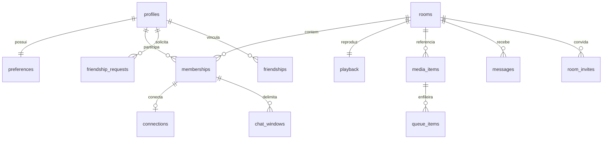

# Banco de dados — especificação proposta v1

Revisão cruzada de 09/11/2026 em [CONSISTENCIA.md](CONSISTENCIA.md): campos e invariantes abaixo foram conciliados com CONTRATOS/ALGORITMOS. Refinamentos continuam proposta técnica, sem aprovação integral, migração ou teste funcional; P01–P15 permanecem confirmados. Esta revisão prevalece sobre notas históricas de incompatibilidade já resolvida.

Decisão P03 confirmada em 09/11/2026: permitir fonte reproduzível de duração inconclusiva, com avanço manual autorizado ao terminar. Refinamento técnico proposto: validation_status/duration_confidence em media_items e termination_mode derivado na reprodução, distinguindo timeline confiável de ação manual; não permitir cliente comum escolher modo/forjar confiança. P02 confirma promoção transacional do primeiro item ao Play inicial. Ver CONTRATOS.md, seção 7. Sem implementação.

Atualização de 09/11/2026: usuário confirmou manter as mensagens já vistas antes da queda, sem recuperar o intervalo desconectado; notificações de convites/solicitações também com app fechado; uso inicial em teste fechado com amigos. P11 confirmou cache somente em memória, perdido após morte do processo; fornecedor de push continua aberto. P15 confirmou limites de uso em [PARAMETROS.md](PARAMETROS.md); demais parâmetros de engenharia, retenção e capacidade de infraestrutura continuam propostos e não testados. Nenhuma implementação, infraestrutura, imagem ou publicação.

Decisões confirmadas pelo usuário em 08/11/2026: (1) se o administrador sair e os demais estiverem reconectando, preservar reservas e manter sala temporariamente sem administrador, atribuindo o papel quando alguém retornar; (2) Play após terminar o último vídeo recomeça esse vídeo; (3) pular animações antigas excedentes, mantendo mensagens no chat autorizado. P15 confirmou depois até 5 animações pendentes e pular espera maior que 20 s, sem apagar chat/descartar corrente repetida por rotação. Isso não permite recuperar mensagens do intervalo desconectado nem aprova integralmente os mecanismos técnicos. Nenhuma imagem, implementação, publicação ou teste. Esta atualização substitui pendências históricas desses três comportamentos abaixo.

## Avanço — estados e algoritmos (08/11/2026)

Refinamentos descritos em [ALGORITMOS.md](ALGORITMOS.md), seção 14, agora incorporados como proposta técnica ao modelo: administração nula somente awaiting_successor/closed, detecção/geração, avaliação de mídia, contexto persistido e claim da outbox. Não são implementação ou aprovação integral.

Detalhamento de operações: [CONTRATOS.md](CONTRATOS.md). Refinamentos documentais de 08/11/2026: profiles inclui revision bigint; connections inclui last_heartbeat_seq bigint para deduplicar batimentos sem recibo individual. TTL de recibos e rejeição de pedidos expirados precisam ser definidos juntos. Admin nulo é representável em awaiting_successor; variantes de eleição/admin expirado/novos entrantes continuam propostas de T01, sem incompatibilidade estrutural de nulabilidade.

08/11/2026. Somente planejamento, sem SQL executável, banco provisionado ou testes. Regras aprovadas prevalecem; escolhas técnicas abaixo são propostas para revisão. Este documento detalha e, onde indicado, refina ARQUITETURA.md.

## 1. Decisões confirmadas nesta revisão

- Reservar a vaga por 60 segundos durante uma queda de conexão.
- Uma pessoa participa de somente uma sala por vez, incluindo a vaga reservada durante reconexão.
- Ao reconectar, mostrar somente mensagens novas; não recuperar as recebidas durante a desconexão. Sair voluntariamente e entrar de novo também não dá acesso a histórico anterior.

Consequência: participação, conexão e acesso ao chat são conceitos separados. Reconectar dentro do prazo preserva vaga e antiguidade da participação, mas inicia uma nova janela de acesso ao chat. P01 fixa 60 s após detectar queda; mecanismo ainda precisa de especificação. Manter já vistas localmente está confirmado; P11 define cache somente em memória, perdido após morte do processo. Não recuperar mensagens perdidas.

## 2. Convenções e garantias

PK = chave primária; FK = referência a outra entidade; UQ = unicidade. Todo campo é obrigatório salvo quando marcado `?`. UUID para ids internos, bigint para sequências/versões/posições em ms, timestamptz para instantes do servidor, boolean para flags e text validado para estados. Não usar JSON como substituto dos relacionamentos centrais.

Defaults técnicos propostos: ids aleatórios no servidor; criação com horário do servidor; versões em zero e incremento a cada alteração do domínio. Defaults funcionais aprovados: sala pública, apenas administrador controla, mensagem horizontal embaixo. P10 define ambos os avisos inicialmente ligados; P15 fixa apelido 2–24, nome da sala 2–60, mensagem até 500 caracteres e fila até 50 próximos; contagem Unicode e demais tetos técnicos ainda precisam de especificação.

Integridade de uma linha: NOT NULL/CHECK. Relações: FK, inclusive composta quando a entidade precisa pertencer à mesma sala. Exclusividade: UQ ou índice único parcial. Regras entre várias linhas, como capacidade, exigem operação transacional; não usar CHECK com consulta a outra tabela. [PostgreSQL — constraints](https://www.postgresql.org/docs/current/ddl-constraints.html).

## 3. Modelo relacional

Diagrama resumido: amizade tem duas referências a profiles; convite tem remetente e destinatário; administrador aponta para uma participação da própria sala. Não é diagrama de migrações executadas.

### Identidade e preferências

| Entidade | Campos e tipos | Regras |
|---|---|---|
| profiles | user_id UUID PK/FK auth.users; public_code text UQ; nickname text; revision bigint; created_at/updated_at timestamptz | Sem email/senha no perfil do app. Código pessoal é identificador compartilhável, não credencial. Apelido não é único |
| preferences | user_id UUID PK/FK profiles; overlay_position text; overlay_size_key text; overlay_speed_key text; notify_invites boolean; notify_friendships boolean; revision bigint; updated_at timestamptz | Posição top/bottom; chaves de tamanho/velocidade mapeadas para valores posteriores; atualização com versão para evitar sobrescrever alteração recente |

Identidade anônima persistente continua proposta de mecanismo técnico. Não remover usuários anônimos por idade indiscriminadamente: amizades dependem deles. Uma reinstalação não deve restaurar credenciais por backup. Contrato de sessão/armazenamento Android será detalhado em outra etapa.

### Sala, participação e conexão

| Entidade | Campos e tipos | Regras |
|---|---|---|
| rooms | id UUID PK; name text; visibility text; status text; admin_state text; admin_membership_id UUID?; revision bigint; created_at/closed_at? timestamptz | public/private; active/closed. Ativa com admin_state=assigned exige administrador; ativa com awaiting_successor permite admin nulo para preservar reservas, conforme decisão confirmada. Encerrada tem closed_at, admin_state=none e administrador nulo. Nomes dos estados são proposta técnica |
| room_codes | room_id UUID PK/FK rooms; code text UQ; invalidated_at? timestamptz | Tabela privada, somente operações autorizadas resolvem/revelam código; nunca listada ao app |
| memberships | id UUID PK; room_id UUID FK; user_id UUID FK; join_order bigint; joined_at timestamptz; state text; can_control boolean; ended_at? timestamptz; end_reason? text | active/grace/ended; índice único por user_id para active ou grace garante uma sala por pessoa; UQ(room_id,join_order), UQ(room_id,id) e UQ(room_id,id,user_id) para FKs que também vinculam remetente/ator |
| connections | membership_id UUID PK/FK; generation bigint; last_heartbeat_seq bigint; last_seen_at timestamptz; suspect_at timestamptz; detected_at? timestamptz; detection_source? text; grace_deadline timestamptz | Uma conexão lógica vigente por participação. detected_at é detecção pelo servidor, não queda física; substitui o nome ambíguo disconnected_at. active saudável usa suspect_at=last_seen_at+D e prazo candidato suspect_at+60 s; após detecção, deadline=detected_at+60 s fica fixo até reconexão formal. Nova geração invalida pacotes antigos; seq duplicada não renova prazo |
| room_bans | room_id/user_id UUID PK composta; actor_id UUID FK; created_at timestamptz | Impede retorno da mesma identidade até encerramento da sala |
| room_counters | room_id UUID PK/FK; last_message_seq bigint; last_join_order bigint; queue_revision bigint | Incrementos apenas no servidor; não reiniciar contadores durante sala ativa |
| chat_windows | id UUID PK; room_id/membership_id UUID; generation bigint; start_after_seq bigint; end_at_seq? bigint; created_at timestamptz | FK composta para participação na mesma sala; uma janela aberta por participação; só janela aberta deve coincidir com geração vigente por validação transacional; janelas fechadas preservam geração histórica, sem FK à geração mutável de connections |

Refinamentos sobre ARQUITETURA.md: administrador aponta para participação, em vez de somente usuário; o limite de chat sai de memberships para chat_windows, pois reconexão tem política própria. Conexão registra a geração vigente, sem precisar acumular cada heartbeat em histórico.

O código de sala precisa ser recuperável para copiar/compartilhar. Proposta v1: texto em tabela privada, protegido por acesso restrito e operações; não fingir que hash irreversível permite recuperar o original. Isso simplifica operação, mas não protege contra acesso privilegiado ao banco. Se o modelo de ameaça exigir criptografia adicional, definir ciphertext, chave externa, rotação e índice de busca por HMAC antes de implementar. Comprimento/alfabeto ainda pendentes; código não deve ser sequencial nem reutilizado enquanto seu registro existir.

FK composta rooms(id,admin_membership_id) → memberships(room_id,id), verificável ao fim da transação, impede administrador de outra sala. A referência circular usa ids pré-gerados e integridade diferida. No commit, assigned exige admin não nulo com participação válida active/grace; awaiting_successor exige admin nulo e reservas válidas sem conectado elegível; closed exige admin_state=none e admin nulo. Grace do admin preserva o papel até prazo, mas não habilita comandos sem conexão LIVE. Estado elegível é revalidado transacionalmente, não só pela FK.

### Reprodução, fila e chat

| Entidade | Campos e tipos | Regras |
|---|---|---|
| media_validations | id UUID PK; actor_id UUID FK profiles; room_id/membership_id UUID; source_url text; source_digest text; status text; kind? text; title? text; duration_ms? bigint; duration_confidence? text; source_fingerprint? text; assessed_at?/expires_at? timestamptz; created_at timestamptz | pending/valid/invalid/inconclusive/expired. UQ(room_id,id); FK composta (room_id,membership_id,actor_id) para participação/dono. valid/inconclusive admitidos exigem formato VOD e verificações de segurança concluídas; duração confiável só em valid com confidence=verified e valor positivo. Ticket lógico é referência a este resultado privado, não dado fornecido como prova pelo app |
| media_items | id UUID PK; room_id UUID FK; validation_id UUID; FK composta (room_id,validation_id) para media_validations; source_url text; kind text; title? text; duration_ms? bigint; duration_confidence text; source_fingerprint? text; assessed_at/created_at timestamptz; created_by UUID FK | mp4/hls; duration_confidence=verified/inconclusive, copiada da avaliação admitida; verified exige duração positiva, inconclusive não autoriza autoavanço. UQ(room_id,id). Avaliação deve pertencer ao ator/sala/participação e mesma URL na admissão; nome sem título usa marcador da UI, sem título inventado. Não buscar fonte dentro de transação |
| playback | room_id UUID PK/FK; media_id UUID?; media_epoch bigint; status text; position_ms bigint; reference_at timestamptz; revision bigint | empty/paused/playing/ended. empty exige mídia nula/posição zero; demais exigem mídia da mesma sala por FK composta. termination_mode e expected_end_at são derivados na API, não campos independentes mutáveis. Em closed, manter tombstone empty, sem mídia e sem permitir replay |
| queue_items | id UUID PK; room_id UUID FK; media_id UUID; position integer; added_by UUID FK; created_at timestamptz | position ≥ 1; UQ(room_id,position) diferível para reordenar; FK composta da mídia. P09 permite URL repetida em itens independentes; retry do mesmo pedido não duplica item |
| messages | room_id UUID + seq bigint PK composta; sender_membership_id UUID; sender_id UUID; client_message_id UUID; sender_nickname text; body text; created_at timestamptz | UQ(sender_id,client_message_id); FK composta de sala/participação/remetente; sender_nickname captura apelido do perfil no commit e não muda ao editar perfil (P08); texto não vazio, até 500 caracteres (P15), contagem Unicode a especificar |

Reprodução atual não é um item entre os próximos. Avançar retira primeiro item da fila, atualiza playback e renumera os restantes na mesma transação. A duração declarada pelo cliente não autoriza sozinha avanço automático; isso pertence ao contrato de validação de mídia.

Contrato proposto da avaliação: estado valid ou inconclusive deve estar não vencido ao admitir addToQueue/playNow, sem assegurar disponibilidade futura da fonte. media_items mantém snapshot imutável da proveniência/confiança admitida; expiração posterior do ticket impede nova admissão com ele, sem mudar silenciosamente a confiança da mídia já admitida. Divergência da fonte é falha de validação/disponibilidade, não promoção automática de confiança. termination_mode=server_timeline somente para duração verified; caso contrário authorized_manual (P03); em empty, null. expected_end_at é derivado apenas para playing/server_timeline a partir de position_ms/reference_at/duration_ms. Estratégia de reavaliação de fonte mutável e executor continuam T03/T04.

Janela de chat proposta: no commit da entrada/reconexão, capturar last_message_seq sob o mesmo bloqueio usado por sendMessage; só mensagens com seq maior que start_after_seq são novas para essa janela. Cursor enviado pelo cliente nunca reduz esse limite. Réplicas/eventos em trânsito da geração antiga são descartados no cliente. Manter mensagens já vistas no cache local está confirmado; janela atual não concede leitura de janelas antigas. P11 define cache somente em memória, perdido após morte do processo. Não devolver o intervalo desconectado por paginação, snapshot, Realtime ou recibos.

### Amizade e convites

| Entidade | Campos e tipos | Regras |
|---|---|---|
| friendship_pairs | user_low/user_high UUID PK composta; created_at timestamptz | Par canônico, low < high; linha técnica de coordenação para serializar solicitações cruzadas, aceite, remoção e convites |
| friendship_requests | id UUID PK; sender_id/recipient_id UUID FKs; user_low/user_high UUID; status text; created_at/resolved_at? timestamptz | pending/accepted/rejected/cancelled; par corresponde exatamente aos envolvidos; UQ parcial do par quando pending |
| friendships | user_low/user_high UUID PK composta/FK friendship_pairs; created_at timestamptz | Existência significa amizade aceita. Remoção elimina vínculo, não perfis |
| room_invites | id UUID PK; room_id UUID FK; sender_id/recipient_id UUID FKs; status text; created_at/used_at? timestamptz | pending/used/room_closed; UQ parcial(room_id,recipient_id) quando pending; uso exige entrada concluída |

Amizade não precisa de uma linha para cada direção. Linha técnica do par permite bloquear mesmo quando a amizade ainda não existe. P07 confirmou aceite explícito nas cruzadas; remetente cancela enquanto pending; qualquer envolvido remove amizade bilateral com confirmação. Preservar perfis e convites emitidos até uso/encerramento.

Convite não reserva vaga e não é consumido quando sala está lotada. Regra já aprovada mantém validade até uso ou encerramento; portanto não invalidar automaticamente por remoção de amizade sem nova decisão. Convite usado repetidamente retorna estado já usado e não duplica participação. Recibos não podem conceder acesso depois da saída/expulsão.

### Controle interno e notificações

| Entidade | Campos e tipos | Regras |
|---|---|---|
| command_contexts | id UUID PK; actor_id UUID FK profiles; contract_version text; issued_at/expires_at timestamptz; revoked_at? timestamptz | Contexto opaco emitido pelo servidor; pertence à identidade autenticada, não concede acesso a sala. Precisa existir, estar não revogado e não vencido para execução nova. Proposta persistida dispensa escolher entre ticket assinado e tombstone para esse papel |
| command_receipts | actor_id/request_id UUID PK composta; command_context_id UUID FK command_contexts; operation text; payload_hash text; resource_id UUID?; result_code text; result_revision bigint?; created_at/expires_at timestamptz | Guardar resultado mínimo, sem chat, token ou URL. Retenção nunca menor que expires_at do contexto mais margem de retry. Contexto inexistente/vencido não admite execução nova; recibo existente pode retornar resultado mínimo sem restaurar acesso |
| rate_buckets | subject_key text + operation text PK composta; tokens numeric; updated_at timestamptz | Token bucket atômico; valores/prazos pendentes; não exposto ao cliente |
| notification_outbox | id UUID PK; recipient_id UUID FK; event_key text UQ; resource_id UUID; kind/status text; attempts integer; next_attempt_at/created_at timestamptz; lease_until? timestamptz; attempt_token? UUID; delivered_at? timestamptz | pending/leased/delivered/failed/suppressed. leased exige lease_until e attempt_token; terminal limpa claim. Conclusão só se token e estado leased ainda coincidirem. Worker revalida recurso/preferência antes de enviar, fora da transação. Supressão invalida claim para conclusão antiga não sobrescrever estado |
| device_tokens (condicional) | id UUID PK; user_id UUID FK; token text UQ; updated_at timestamptz; revoked_at? timestamptz | Somente se houver push escolhido. Sem token ou credencial no log |

Predicados de acesso seguem [CONTRATOS §1](CONTRATOS.md#sec-01): LIVE, CONTROL e ADMIN são revalidados com fase efetiva/generation. Expiração de registro armazenado não é renovada por leitura/worker atrasado.

Outbox e tokens não são confirmação de escolha de fornecedor de push. Fornecedor/transporte e detalhes operacionais ainda serão planejados; P10 define ambos os avisos ligados e texto discreto sem nomes na tela bloqueada.

## 4. Acesso aos dados

Proposta: tabelas internas em esquema não exposto; API pequena de operações e projeções. Não conceder CRUD genérico das tabelas ao Android. Segurança em profundidade: RLS nos dados expostos, grants mínimos e checagem explícita de identidade/permissão em operações privilegiadas. RLS controla linhas, não oculta automaticamente colunas sensíveis. Views e funções precisam revisão própria. [Supabase — RLS](https://supabase.com/docs/guides/database/postgres/row-level-security).

| Grupo | Leitura permitida pela API | Mutação |
|---|---|---|
| profiles/preferences | Dono completo; apelido/inicial em projeções autorizadas de amigo, solicitação ou sala; código próprio ou busca exata limitada | Dono, campos permitidos, via operação |
| rooms/codes | Catálogo mínimo a autenticados; detalhes/código só LIVE; grace só status mínimo próprio | Criar/entrar/sair; administração exige ADMIN |
| memberships/connections/bans | Participantes recebem projeção de pessoas/permissões; lease e registros de bloqueio internos | Apenas operações de sala e worker |
| playback/media/queue | LIVE na mesma sala; avaliações só dono e LIVE na participação vinculada | CONTROL; avanço automático interno só server_timeline; manual inconclusivo exige CONTROL |
| messages/chat_windows | LIVE, janela atual/geração válidas e limite de sequência | Envio por LIVE com limite; janela somente servidor; apagar ao encerrar |
| friendship_pairs/requests/friendships | Par interno oculto; envolvidos veem solicitações/vínculo por projeção | Ator adequado: remetente solicita/cancela, destinatário aceita/recusa, envolvido remove |
| room_invites | Destinatário lê convites; remetente recebe resultado mínimo do envio | Envio validado; consumo/encerramento transacionais |
| receipts/buckets/outbox/tokens | Sem leitura genérica de app; operação específica retorna status mínimo | Servidor/worker; registro de token só para próprio usuário |

Operações privilegiadas devem ter search_path controlado, nomes qualificados, EXECUTE restrito, ator derivado da sessão, sem confiar no user_id do payload. Preferir invoker quando suficiente; definer apenas quando necessário e com verificações completas. [Supabase — funções](https://supabase.com/docs/guides/database/functions).

Revogação exige checagem em cada leitura/mutação; evitar dados sensíveis em Broadcast que sobreviva à expulsão. Erros de código privado não revelam nome ou ocupação da sala a desconhecidos. Catálogo público não expõe URL, código ou lista de identidades.

## 5. Transações e invariantes

Uma operação deve terminar inteira ou não alterar nada. Ordem proposta para locks: recibo de pedido → perfis envolvidos em ordem de UUID → par de amizade, quando houver → salas em ordem de UUID → participação/conexão → reprodução/contadores/fila/convites. Nunca adquirir perfil/par depois de bloquear sala; contratos futuros devem manter essa ordem ou separar fases com revalidação. Worker de encerramento não deve sair do bloqueio de sala para adquirir perfil/par.

Localizar recursos sem lock não autoriza execução; após adquirir locks, reler identidade, prazos, geração e revisões. Usar horário do servidor amostrado após os locks relevantes, não horário antigo da abertura da requisição. Para sendMessage, adquirir perfil do ator antes da sala e capturar nickname sob esses locks: changeNickname fica ordenado em relação ao envio, sem adquirir perfil depois da sala. Workers de sala não precisam bloquear perfis; exclusividade de participação e releitura das salas resolvem expiração/entrada concorrente. Contexto é verificado sem lock invertido; uma revogação concorrente precisa ponto de decisão especificado em T05.

Fechamento de sala é transição única: status closed/closed_at, participações ended, janelas fechadas, admin_state=none/admin nulo, código/convites inválidos e chat removido. Primeiro retirar referência playback (media_id=null, status empty, posição zero), incrementar epoch/revisão, limpar fila e então excluir mídia/avaliações elegíveis segundo retenção. Manter tombstone mínimo enquanto necessário a retries; não apagar cegamente avaliação ainda referenciada. Fim de fila em sala ativa é ended com mídia preservada, diferente de fechamento.

room_revision é rooms.revision; playback_revision é playback.revision; queue_revision é room_counters.queue_revision; revisões de perfil/preferências correspondem ao campo revision de cada tabela. Incrementar room_revision uma vez por transação com mudança de participantes/estado efetivo/contagem/admin/permissões; playback_revision por mudança de execução/posição/estado; queue_revision somente quando conteúdo/ordem da fila muda. Heartbeat saudável sem mudança visível não incrementa room_revision. Promoção com fila incrementa player/fila juntos; término sem próximos altera apenas player; encerramento incrementa fila somente se a limpar. Eventos pós-commit levam as revisões alteradas.

| Operação | Garantia no commit |
|---|---|
| Criar sala | Sala, administrador, participação, código, contadores e reprodução vazia existem juntos |
| Entrar | Perfil bloqueado impede duas entradas simultâneas em salas distintas; sala bloqueada impede exceder 10 vagas; índice único é defesa adicional |
| Reconectar | Prazo válido, geração substituída, vaga preservada, nova janela de chat; não aceitar heartbeat antigo |
| Queda | Vaga active/grace continua ocupada até prazo; limpeza atrasada não concede extensão automática: operações verificam deadline |
| Sair | Participação termina e libera vaga; se admin, sucessão; se último, encerramento imediato |
| Aceitar amizade | Pendência resolvida e vínculo criado juntos, apenas pelo destinatário |
| Usar convite | Validar identidade/sala/bloqueio/vaga, criar participação e marcar usado na mesma transação |
| Encerrar | status closed, participações encerradas, código invalidado, convites pending → room_closed, chat apagado e notificações inválidas suprimidas |

Regra aprovada: no máximo 10 vagas incluindo grace. P05 confirmado: contagem visual dos cards e sala inclui somente conectados. Separar connected_count de occupied_slots; reservas válidas consomem vagas, sem inflar número visível. Exemplo: 8 conectados + 2 reservas mostra 8 pessoas, mas rejeita nova entrada por lotação. Sucessor precisa estar conectado elegível, não somente possuir vaga em grace. Sem candidato conectado, preservar reservas e aguardar retorno conforme regra aprovada.

## 6. Consultas e índices propostos

- Home/listagem: somente active/public, exibir connected_count (conexões elegíveis, não grace). Capacidade de entrada usa occupied_slots (conectados + reservas válidas). Ordenar por connected_count decrescente, created_at decrescente e id estável como proposta técnica alinhada ao número visível; ordenação não foi perguntada separadamente em P05. Até três na Home. Agregação inicial evita contador divergente; custo deve ser medido antes de materializar.
- Busca por nome: correspondência sem distinção de maiúsculas é proposta; acentos e busca parcial ainda por definir. Índice especializado depende de volume e regra escolhida.
- Chat: PK(room_id,seq) atende intervalo e paginação; aplicar janela antes do LIMIT. Não usar apenas cursor controlado pelo cliente.
- Participação: índice único parcial(user_id) para active/grace; índice(room_id,state,join_order); índice conexões(grace_deadline) para rotina de vencimento.
- Fila: UQ(room_id,position); solicitações por (recipient_id,status,created_at,id) e remetente; convites por (recipient_id,status,created_at,id).
- Outbox: índice parcial(next_attempt_at,id) para pendentes; recibos por expires_at; códigos UQ; criar índices nas FKs usadas em exclusão/consulta, evitando duplicar PK/UQ.

Ranking público muda com ocupação: cursor não torna páginas uma fotografia imutável. Proposta v1: atualização explícita, deduplicação por id e consistência eventual na listagem; entrada sempre revalida vaga. Se exigida navegação estável entre páginas, planejar snapshot de ranking com expiração.

## 7. Retenção e exclusão

| Dados | Regra ou proposta |
|---|---|
| Mensagens | Regra aprovada: apagar ao encerrar. Remover também cópias em caches do app quando receber encerramento; clientes offline não têm garantia de apagamento instantâneo |
| URLs/fila/avaliações | Proposta: retirar referências de playback e fila antes de excluir mídia/avaliações elegíveis; TTL/retenção de avaliações ainda T08; não deixar FK órfã ou manter URL em recibos/logs |
| Sala/código/participações | Proposta: tombstone mínimo temporário para reconhecer encerramento/retries; prazo ainda aberto |
| Convites/solicitações resolvidos | Proposta: retenção operacional curta; prazo aberto |
| Perfis/amizades | Persistentes enquanto identidade existir; política de abandono/exclusão ainda a definir |
| Recibos/buckets/outbox | Prazos alinhados a retries e auditoria mínima, ainda abertos; outbox não contém corpo do chat |
| Backups/logs | Apagar do banco ativo não apaga retroativamente backups; definir janela e procedimento de restauração que reaplique encerramentos/remoções |

Não usar cascade cego para apagar um perfil administrador. Remoção de identidade exige primeiro resolver participações/sucessão. Sala é raiz de seus dados efêmeros, mas fechamento funcional é transação explícita, não simples DELETE de rooms.

## 8. Revisão de consistência e pendências

Cenários para futura validação: duas entradas na última vaga; duas salas concorrendo pela mesma pessoa; reconexão exatamente no prazo; pacote antigo após reconectar; mensagens entre queda e retorno inacessíveis por todos os caminhos; convite usado duas vezes; mídia de outra sala rejeitada; fila reordenada sem colisão; administrador saindo com todos os demais em grace; recibo antigo após expulsão; encerramento concorrente com sendMessage.

Ainda não fechado: semântica técnica de contagem Unicode, tetos de bytes, códigos e tentativas; mecanismo de detecção e fronteira temporal; detalhes de transporte e reenvio social; retenção; push; remoção de identidade e backups. Esses pontos impedem chamar o banco de especificação final, mas não impedem revisar os contratos propostos.

Próxima etapa de planejamento: contratos de cada método (payload, resposta, autorização, transação, conflito, retry e eventos), usando este modelo. Não iniciar implementação automaticamente.
