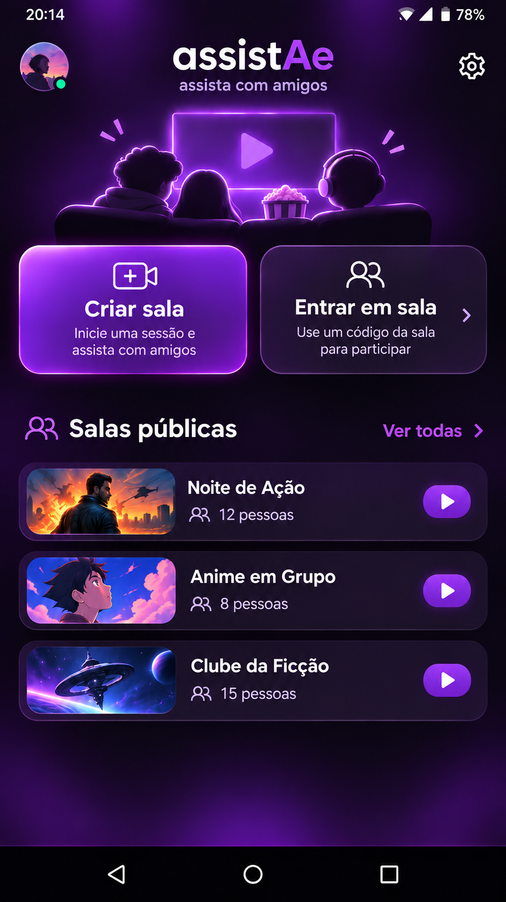
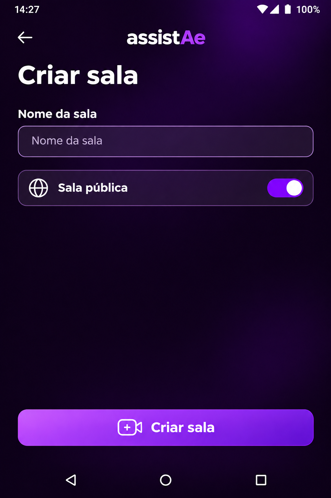
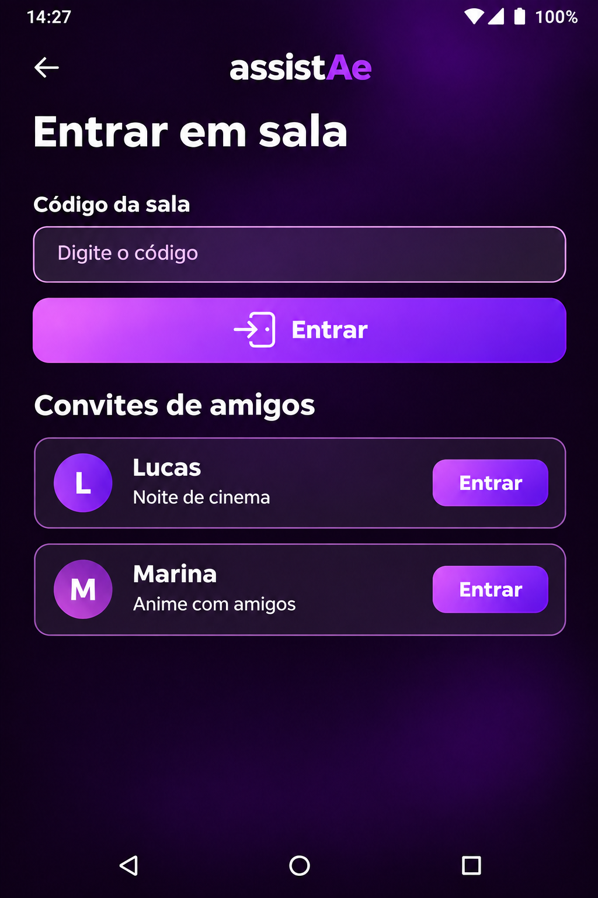
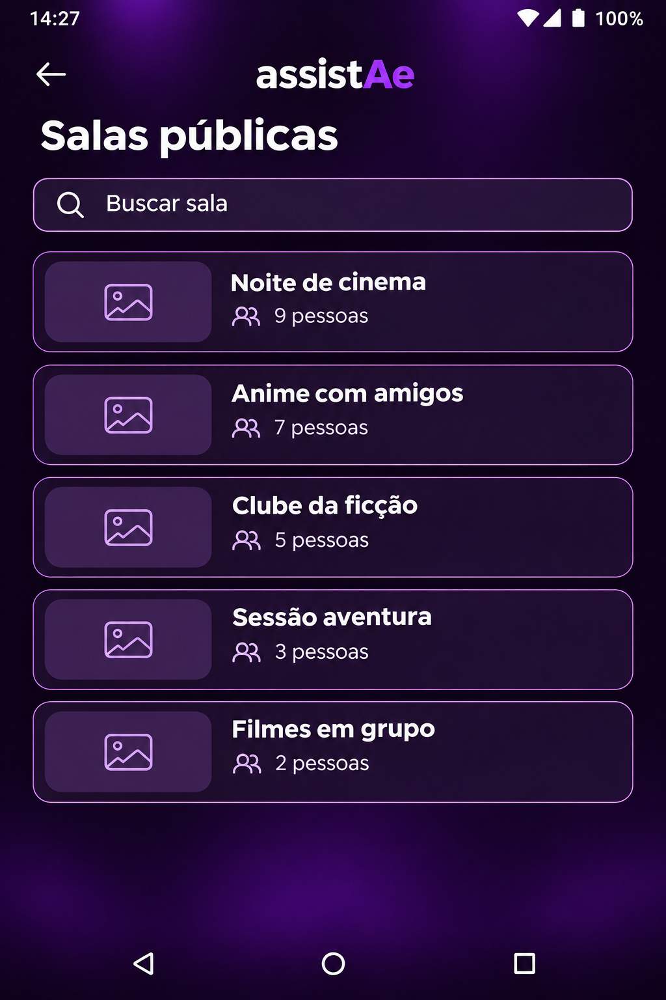
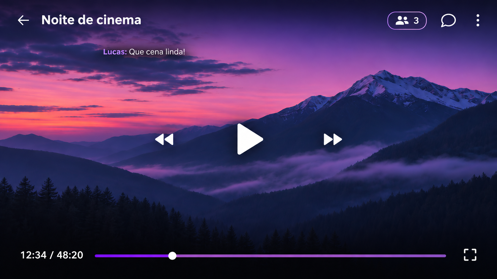

# Controle de design

## Avanço de implementação e aparelho — 09/11/2026

Backend possui 16 migrações, 23 tabelas privadas e 30 RPCs: identidade/preferências, salas/catálogo, leases/reconexão, chat/administração, amizade/convites e status de comandos. Dezessete suítes SQL passaram. Aceite explícito nas cruzadas, remoção bilateral preservando convites emitidos, outbox sem envio push. Papéis de API limitados, sem login/BYPASSRLS/DDL permanente. Locks de perfis UUID antes de par/sala/FKs; disputa entre duas sessões ainda não demonstrada. [Estado, decisões técnicas e evidências](IMPLEMENTACAO.md). Pendentes mídia/fila, dispatcher push, Realtime e app Android/APK; Auth/REST e aparelho não validados. P01–P15/design preservados, B00/blocos completos não concluídos. Galaxy A54 com Play Store confirmado, APK direto, somente Android; versões exatas do SO não informadas. Sem imagem nova, publicação de APK ou notificações reais enviadas. Notas abaixo são históricas.

## Implementação do banco iniciada — 09/11/2026

Autorização mais recente permite implementar começando pelo Supabase. Foram implementados schema privado e identidade/preferências no backend; cinco suítes SQL executadas, sem validação visual/Android. Referências e cards aprovados preservados, sem imagem gerada, alterada ou enviada. Design não é captura de app pronto. Evidências e próximos blocos em [IMPLEMENTACAO.md](IMPLEMENTACAO.md).

## Revisão de consistência técnica — 09/11/2026

Banco, contratos e estados revisados em [CONSISTENCIA.md](CONSISTENCIA.md). Distinguir fim de fila (ended com mídia para replay) de sala encerrada (closed sem referência de mídia); status mínimo/reconexão não liberam chat ou controles. Validação assíncrona usa carregamentos/feedbacks existentes; nenhum fluxo visual novo aprovado. P01–P15 preservados, sem imagem gerada/alterada, implementação ou teste funcional. B00 permanece aberto.

## Navegação das referências por bloco — 09/11/2026

Os guias de [B01](BLOCOS.md#b01), [B03](BLOCOS.md#b03), [B04](BLOCOS.md#b04), [B05](BLOCOS.md#b05), [B06](BLOCOS.md#b06), [B07](BLOCOS.md#b07), [B08](BLOCOS.md#b08) e [B09](BLOCOS.md#b09) agora apontam às seções visuais e funcionais pertinentes. Âncoras estáveis adicionadas às referências existentes, sem alterar imagens ou regras. Apenas organização documental; nenhuma aprovação visual adicional, implementação ou teste funcional. Aprovações e pendências descritas nas seções originais permanecem válidas.

## P13–P15 confirmados — 09/11/2026

Voltar fecha teclado/painel, horizontal retorna ao vertical e vertical confirma saída, reutilizando modelos de confirmação. Parar externo só local; saltos de 10 s por autorizado. Adicionar vídeo aceita HTTP e HTTPS diretos, sem indicar HTTP como inválido por protocolo. Limites iniciais: apelido 2–24 caracteres, sala 2–60, mensagem até 500, fila até 50 próximos e animações pendentes até 5/espera maior que 20 s. Preservar texto do chat e animação corrente repetida na rotação; feedbacks usam componentes existentes. P01–P15 confirmados. Sem imagem ou aprovação visual adicional, implementação ou teste; revisão técnica ainda aberta. Esta seção prevalece sobre pendências históricas desses temas.

## P10–P12 confirmados — 09/11/2026

Notificações: ambos os avisos ligados inicialmente; texto discreto sem nomes na tela bloqueada; permissão Android distinta de preferência. Chat: cache só em memória, preservado na queda/rotação do mesmo processo e perdido ao morrer processo. Horizontal: reticências apenas na animação, texto completo no chat; repetir do início a animação interrompida ao girar, antes das próximas em ordem, sem repetir concluídas ou reenviar mensagem. Reutilizar referências/componentes existentes; sem imagem nova, aprovação visual adicional, implementação ou teste. P01–P12 não devem ser reapresentados; esta seção substitui pendências históricas desses comportamentos.

## Alinhamento funcional P07–P09 — 09/11/2026

Confirmados aceite explícito nas solicitações cruzadas, cancelamento pelo remetente enquanto pendente e remoção bilateral por qualquer envolvido com confirmação; preservar convites emitidos até uso/encerramento. Reutilizar cards/confirmadores existentes para esses fluxos. Chat preserva apelido usado no envio; URL repetida é permitida em itens independentes da fila. Sem nova aprovação visual ou imagem; nenhuma implementação/teste. P01–P09 confirmados; escolhas restantes em DECISOES.md. Conciliação documental em B00.1 avançou; tipos/estados/segurança ainda precisam revisão técnica.

## Revisão do repositório e divisão em blocos — 09/11/2026

Proposto [BLOCOS.md](BLOCOS.md), com B00–B09, dependências e critérios de aceite. Referências aprovadas preservadas; ajustes de Configurações com Amigos, solicitações enviadas, sucessor, permissões e feedbacks reutilizam componentes existentes nos respectivos blocos. Nenhuma imagem criada/editada, aprovação visual nova, implementação ou teste funcional. B00 permanece planejamento; confirmações P01–P06 prevalecem sobre registros históricos abaixo.

P04–P06 confirmados em 09/11/2026: suspensão pelo Android quando pausado/sem vídeo segue reconexão normal, com reserva de 60 s após detecção; número visível nos cards e sala conta somente conectados, mas reservas válidas ainda ocupam o limite de 10; ex-administrador preserva apenas sua permissão individual anterior, sem ganhar controle automaticamente ao transferir. Áudio durante reprodução em segundo plano permanece requisito. Esta atualização substitui pendências históricas desses comportamentos. Nenhuma imagem, implementação, publicação ou teste.

Lote P04–P06 em análise (09/11/2026): comportamento em background pausado, contagem visual dos reconectando e controles após transferência. Perguntas apresentadas; nenhuma decisão presumida. Preservar cards/referências. Sem imagens, implementação ou teste.

Confirmado em 09/11/2026 (P01–P03 de DECISOES.md): reserva de 60 segundos contada após detectar a queda; Play com sala ainda sem mídia inicia o primeiro item da fila, mas adicionar sozinho não inicia; fonte reproduzível com duração inconclusiva é permitida, com avanço manual por administrador/participante autorizado ao terminar. Essa última regra é exceção explícita ao avanço automático, não permissão a usuário comum. Detecção/limites técnicos e apresentação da ação manual ainda precisam de especificação. Substitui pendências históricas desses três pontos abaixo. Somente planejamento, sem implementação/testes.

## Fechamento do planejamento — registro único (09/11/2026)

Criado [DECISOES.md](DECISOES.md), separando decisões confirmadas, escolhas abertas de produto, trabalho técnico e informações operacionais. Não reabrir decisões já confirmadas por causa de pendências históricas abaixo. Perguntas atuais P01–P03: origem dos 60 segundos, primeiro Play com fila e fonte com duração inconclusiva; respostas ainda pendentes nesta atualização. Design preservado. Nenhuma imagem, código, infraestrutura, publicação ou teste funcional. Próximo passo: incorporar respostas e fechar contratos afetados, permanecendo no planejamento.

## Avanço — segurança e testes planejados (09/11/2026)

Criado [SEGURANCA-TESTES.md](SEGURANCA-TESTES.md): fronteiras de confiança, matriz por tabela, RLS/grants/funções, revogação Realtime, credenciais, riscos do validador e casos de segurança, concorrência, Android, notificações e operação. Critérios de aceite documentados; todos os testes não executados. Parâmetros e decisões pendentes continuam explícitos, sem aprovação integral. Design preservado, sem imagens ou código. Nenhuma infraestrutura, publicação ou teste funcional. Próximo planejamento: consolidar decisões abertas e fechar bloqueadores em pequenos lotes; não iniciar implementação.

## Avanço — arquitetura Android e infraestrutura (09/11/2026)

Criado [ANDROID-INFRA.md](ANDROID-INFRA.md): camadas/pacotes, coordenador único de sala, MediaSessionService/player, foco de áudio, controles externos, cache, API Supabase, push, validador, ambientes e APK. Proposta técnica baseada em documentação oficial; nenhum projeto/serviço criado. Restrições a fechar: presença em background quando pausado/sem mídia, aparelhos-alvo, fornecedor de push, executor de metadados e fonte inconclusiva. Design preservado, sem nova arte ou aprovação visual. Nenhuma implementação, publicação ou teste funcional. Próximo planejamento: segurança/RLS e matriz de testes/aceite, além dessas decisões operacionais.

Atualização de 09/11/2026: usuário confirmou manter as mensagens já vistas antes da queda, sem recuperar o intervalo desconectado; notificações de convites/solicitações também com app fechado; uso inicial em teste fechado com amigos. Cache persistente após morte do processo e fornecedor de push não foram definidos. P15 confirmou limites de uso em [PARAMETROS.md](PARAMETROS.md); demais parâmetros de engenharia, retenção e capacidade de infraestrutura continuam propostos e não testados. Nenhuma implementação, infraestrutura, imagem ou publicação.

Decisões confirmadas pelo usuário em 08/11/2026: (1) se o administrador sair e os demais estiverem reconectando, preservar reservas e manter sala temporariamente sem administrador, atribuindo o papel quando alguém retornar; (2) Play após terminar o último vídeo recomeça esse vídeo; (3) pular animações antigas excedentes, mantendo mensagens no chat autorizado. P15 confirmou depois até 5 animações pendentes e pular espera maior que 20 s, sem apagar chat/descartar corrente repetida por rotação. Isso não permite recuperar mensagens do intervalo desconectado nem aprova integralmente os mecanismos técnicos. Nenhuma imagem, implementação, publicação ou teste. Esta atualização substitui pendências históricas desses três comportamentos abaixo.

## Avanço — estados e algoritmos (08/11/2026)

Planejamento de estados e algoritmos em [ALGORITMOS.md](ALGORITMOS.md). Nenhuma referência alterada ou imagem criada. Estado interno awaiting_successor proposto não é sala de espera nem tela nova; avisos usam componentes existentes. Play em ended e excesso de animações aguardam decisão. Sem aprovação visual nova, implementação ou teste.

## Avanço técnico — contratos (08/11/2026)

Contratos propostos em [CONTRATOS.md](CONTRATOS.md). Validação, conflitos, permissão e falhas devem usar campos/cards/avisos aprovados; autosave continua restrito a notificações. Sem imagem nova, alteração de referência, aprovação visual adicional, implementação ou teste Android.

## Avanço de planejamento — banco v1 (08/11/2026)

Criado [BANCO.md](BANCO.md), proposta técnica sem mudanças de imagem. Usuário confirmou vaga reservada por 60 segundos, uma sala por pessoa e somente mensagens novas após reconexão. Cards e estados existentes serão reutilizados; contagem visual de reconectando e manutenção do chat já visto ainda precisam de regra. Nenhuma nova referência visual aprovada, implementação ou teste Android.

**Correção de escopo — 08/11/2026:** usuário pediu planejar integralmente banco, métodos, algoritmos, segurança, contratos, operação e testes antes do desenvolvimento. Não iniciar código, projeto Android, migrações executáveis ou provisionamento por consequência deste planejamento. O design existente continua como base e ajustes reutilizam os mesmos cards. A proposta técnica inicial está em [ARQUITETURA.md](ARQUITETURA.md). Ainda há decisões abertas; não declarar planejamento concluído ou aprovado. Implementação somente após solicitação posterior do usuário. Esta correção prevalece sobre referências anteriores a construir a base/navegação como próximo passo. Nesta revisão: somente documentação, sem imagens, publicação, implementação ou testes funcionais.

## Etapa atual — planejamento do desenvolvimento (08/11/2026)

O usuário considera o design pronto para avançar e determinou reutilizar os mesmos modelos de cards em ajustes necessários. Esta orientação substitui a exigência de novas prévias antes do desenvolvimento e a sequência antiga Fila → Adicionar vídeo → Participantes. Preservar Home, referências e regras aprovadas; nenhuma imagem gerada ou editada nesta revisão.

Configurações com Amigos, solicitações enviadas, saída com sucessor, permissões e carregamentos/feedbacks serão detalhados com os componentes existentes. Não são variantes já implementadas ou testadas. Miniatura definitiva continua adiada; teclado será validado no Android, sem nova prévia.

Próxima etapa: [Plano de desenvolvimento](DESENVOLVIMENTO.md). A sequência técnica é proposta; parâmetros abertos não se tornam decisões aprovadas. Nenhum app/backend/APK implementado ou testado. Registros anteriores abaixo são históricos quando conflitarem com esta orientação.

Atualizado em 08/11/2026. Aprovação visual não significa implementação ou teste Android.

## Erros/reconexão e estados vazios — nove propostas em análise

**Estado atual: nove referências aprovadas pelo usuário (“pode mandar”), com envio ao GitHub autorizado.** Código inválido, sala lotada (resultado corrigido), sala encerrada, vídeo inválido, reconectando, sem salas, busca sem resultados, sem amigos e sem convites. Arquivos preservados sem nova edição. Sem implementação/teste. Registros de elaboração abaixo são históricos.

**Cobertura de design ainda incompleta:** referências principais, dez painéis complementares, seis estados/menu/confirmações e estes nove estados têm aprovação. Restam composição principal de Configurações com Amigos, solicitações enviadas com itens, saída do administrador com escolha de sucessor, variantes sem permissão e detalhamento de carregamentos/feedbacks/validações restantes (ex.: nome inválido, solicitação/convite enviado e falha de salvamento). Miniatura definitiva segue adiada; parâmetros numéricos e adaptação Android permanecem pendentes. Usuário dispensou desenho do teclado horizontal, não a validação funcional. Não declarar todo o design concluído.

Usuário dispensou a prévia de chat horizontal com teclado e solicitou somente os lotes 2 e 3 sugeridos. Nove imagens criadas com imagegen integrada, sem editar referências aprovadas, sem implementação/testes e sem autorização de envio destas novas imagens ao GitHub. Conteúdo e comportamento abaixo são propostas para avaliação.

| Prévia local | Estado apresentado |
|---|---|
| [Código inválido](design/propostas/erro-codigo-proposta-v1.png) | Erro junto ao campo Código da sala, editável. Código de exemplo não define formato final. |
| [Sala lotada](design/propostas/sala-lotada-proposta-v1.png) | Aviso de limite de 10 participantes e Entendi; sem espera ou reserva de vaga. |
| [Sala encerrada](design/propostas/sala-encerrada-proposta-v1.png) | Aviso de encerramento e Entendi; não entra na sala. Limpeza/atualização dos convites ao dispensar ainda precisa ser implementada. |
| [Vídeo inválido](design/propostas/video-invalido-proposta-v1.png) | Adicionar vídeo com falha de abertura da URL, ações de reproduzir/adicionar desativadas e orientação para corrigir. Não testa a fonte nem substitui mídia atual. |
| [Reconectando](design/propostas/reconectando-proposta-v1.png) | Aviso local com tentativa automática e Tentar novamente; comandos e envio desativados. Contagem/frame/mensagens são último estado ilustrativo. Não indica pausa dos demais nem demonstra reconexão real. |
| [Sem salas públicas](design/propostas/sem-salas-proposta-v1.png) | Listagem vazia com busca disponível e Nenhuma sala pública no momento. Home vazia segue regra existente, sem redesenho da Home. |
| [Busca sem resultados](design/propostas/sem-resultados-proposta-v1.png) | Termo de exemplo, Nenhuma sala encontrada e Limpar busca. Diferente de não existir nenhuma sala. |
| [Sem amigos](design/propostas/sem-amigos-proposta-v1.png) | Código pessoal e adição disponíveis, solicitações zeradas e lista de amigos vazia. Não representa desenho da aba Enviadas com itens. |
| [Sem convites](design/propostas/sem-convites-proposta-v1.png) | Entrada por código preservada e Convites de amigos vazios. |

Inspeção visual: títulos/ações principais legíveis e presentes, sem cortes aparentes. Em Sala lotada, correção pontual removeu card Marina duplicado no fundo; somente resultado corrigido selecionado. Na reconexão, proporção da mídia deve ser preservada pelo Android; arte ilustrativa não valida proporção/reprodução. Não houve testes de interação, rede, fontes ou teclado. Referências: Entrar em sala, Salas públicas, Adicionar vídeo, player vertical e Amigos aprovados. [Prompts completos](design/propostas/prompts-erros-vazios-v1.md).

Não gerar a prévia com teclado nesta etapa. A dispensa do desenho não comprova suporte a teclado nem dispensa validação do aplicativo. Ainda restam demais estados técnicos, solicitações enviadas com itens, saída com sucessor, estados de permissão e composição de Configurações com Amigos.

## Estados da sala, menu e confirmações — propostas para análise

**Estado atual: seis referências aprovadas visualmente pelo usuário (“gostei do desing pode por la”), com envio ao GitHub autorizado.** Sala sem vídeo, fim da fila, menu, confirmar encerramento, confirmar expulsão e confirmar transferência. Somente a versão final corrigida da transferência integra o envio; a primeira tentativa exibida no chat foi substituída. Seis arquivos distintos conferidos, sem novas alterações de imagem nesta etapa. Sem implementação ou testes Android. Registros de elaboração abaixo são históricos.

Usuário pediu as telas da próxima etapa apresentada. Geradas seis prévias com imagegen integrada, usando o player vertical aprovado como referência de estilo/contexto, sem editar a referência aprovada. Propostas locais aguardando avaliação; sem autorização de envio destas novas imagens ao GitHub, implementação ou testes Android.

| Proposta | Conteúdo e limites |
|---|---|
| [Sala sem vídeo v1](design/propostas/sala-sem-video-proposta-v1.png) | Área sem mídia, “Adicione um vídeo” e orientação para abrir Fila no menu; chat ativo. Sem sala de espera nem botão separado de Adicionar vídeo. |
| [Fim da fila v1](design/propostas/fim-fila-proposta-v1.png) | Último quadro com “Fila vazia”, acesso Abrir fila e chat disponível. Estado proposto para participante autorizado; variantes de permissão ainda pendentes. |
| [Menu da sala v1](design/propostas/menu-sala-proposta-v1.png) | Menu ancorado nos três pontos: Fila, Compartilhar, Sair da sala e Encerrar sala. Visão administrativa; Encerrar fica oculto para os demais na implementação futura. |
| [Confirmar encerramento v1](design/propostas/confirmar-encerrar-proposta-v1.png) | Aviso de encerramento para todos e invalidação do código; Cancelar/Encerrar sala. |
| [Confirmar expulsão v1](design/propostas/confirmar-expulsar-proposta-v1.png) | Participante Lucas como exemplo, Cancelar/Expulsar. Regra existente de bloqueio da mesma identidade permanece; a prévia não garante bloqueio de pessoa após troca de identidade. |
| [Confirmar transferência v1](design/propostas/confirmar-transferir-proposta-v1.png) | Lucas selecionado como novo administrador; atual administrador permanece na sala como participante. Cancelar/Transferir. Não representa fluxo de saída com sucessor ou transferência automática por queda. |

Composição e textos novos são propostas, não aprovações funcionais adicionais. Confirmações de expulsão/transferência apresentadas a pedido do usuário como detalhamento de interação. Ações administrativas continuam no painel de participantes; somente Encerrar fica no menu. Nenhuma ação foi executada em uma sala real. Validação com teclado, acessibilidade, dispositivos, variações de permissão e erros continua pendente. [Prompts completos](design/propostas/prompts-estados-sala-v1.md).

Inspeção visual: seis títulos/estados e ações principais presentes e legíveis, sem cortes aparentes nos elementos principais. Na confirmação de transferência, revisão pontual corrigiu uma mensagem duplicada e o avatar incorreto no chat de fundo; modal preservado. Posicionamento do chat atrás do modal é ilustrativo, sem substituir o layout-base aprovado. Nenhuma inspeção de imagem equivale a teste de interação.

## Quatro painéis de Configurações — propostas v1 para análise

**Estado atual: Mudar apelido v1, Configuração de mensagem v1, Notificações v2 (sem botão Salvar preferências) e Sobre o app v1 aprovados, com envio dessas quatro referências ao GitHub autorizado pelo usuário (“selve elas no github”).** Nomes dos arquivos preservam a origem das prévias. Notificações v1 foi substituída pela v2 e permanece somente local, fora deste envio. Sem implementação ou testes Android. Os registros de elaboração abaixo são históricos; parâmetros e estados complementares continuam pendentes.

**Revisão posterior de Notificações:** usuário pediu retirar Salvar preferências: alterar cada interruptor deve salvar automaticamente. Revisão da imagem por imagegen integrada, com prompt restrito a remover o botão e recompor seu fundo, mantendo os demais elementos. Referência v1 preservada; nova proposta em [Notificações v2](design/propostas/notificacoes-proposta-v2.png). Decisão funcional confirmada, sem aprovação do conjunto das quatro propostas, implementação/teste ou autorização de envio da nova imagem ao GitHub. Padrões ligado/desligado e tratamento de falha de salvamento ainda pendentes. Esta revisão substitui a ação Salvar preferências da descrição histórica abaixo.

Inspeção visual da v2: botão removido, dois interruptores e textos mantidos, sem cortes aparentes. Prompt de edição: remover somente o botão Salvar preferências e preencher a área com o fundo preto/roxo existente, preservar dimensões, cabeçalho, textos, ícones, estados/posições dos interruptores e espaçamento; não adicionar avisos ou novas ações. Ferramenta integrada imagegen, sem CLI.

Compartilhar, Chat horizontal aberto e Amigos aprovados e enviados sem edição ao GitHub no commit `05a0b01`. Usuário pediu gerar os quatro últimos painéis: Mudar apelido, Configuração de mensagem, Notificações e Sobre o app. Criados com imagegen integrada a partir do estilo de Configurações aprovado, sem alterar referências anteriores. Estas quatro novas imagens são propostas locais, sem aprovação ou autorização de envio ao GitHub, sem implementação ou teste Android.

- [Mudar apelido](design/propostas/mudar-apelido-proposta-v1.png): campo com exemplo Lucas, prévia da inicial, Salvar apelido e Cancelar. Inicial é ilustrativa, não edição de avatar. Limites, validação, teclado, feedback e propagação da alteração ainda pendentes.
- [Configuração de mensagem](design/propostas/configuracao-mensagem-proposta-v1.png): prévia ilustrativa, posição cima/baixo (embaixo selecionado), tamanho Menor/Padrão/Maior, velocidade Lenta/Rápida e Salvar ajustes. Sem valores numéricos definidos. Texto ampliado na miniatura não substitui o tamanho pequeno aprovado no player horizontal; não comprova movimento. Faixas, valores, persistência e animação pendentes.
- [Notificações — versão atual v2](design/propostas/notificacoes-proposta-v2.png): dois interruptores — Convites de sala e Solicitações de amizade — com salvamento automático ao alterar, sem botão de salvar. Ligados são exemplos visuais, não definição de padrão. Permissão Android, entrega dos avisos, implementação da persistência e estados pendentes. A v1 com botão foi substituída.
- [Sobre o app](design/propostas/sobre-app-proposta-v1.png): proposta de texto breve sobre assistir junto, salas e chat; sem inventar versão, autoria, contatos ou links. Conteúdo e composição aguardam aprovação.

Inspeção visual das quatro: títulos, campos e ações legíveis, sem cortes aparentes; identidade preta/roxa mantida. São propostas de painéis internos apresentados como subpáginas com voltar; forma final de abertura ainda pode ser revisada pelo usuário. Nenhuma nova funcionalidade foi implementada ou testada. [Prompts completos](design/propostas/prompts-configuracoes-v1.md). Após análise destas quatro, ainda faltam estados complementares, teclado, confirmações, atualização da composição principal com Amigos e miniatura definitiva adiada.

## Novas propostas — Compartilhar, Chat horizontal e Amigos

**Estado atual: Compartilhar, Chat horizontal aberto e Amigos aprovados pelo usuário, com envio dessas três imagens ao GitHub autorizado (“pode mandar pro git essas que vc fez”).** Referências v1 preservadas sem edição; detalhes de estados complementares continuam pendentes. Sem implementação/testes. Histórico da elaboração abaixo.

Fila, Adicionar vídeo e Participantes aprovados e enviados ao GitHub com documentação no commit `9fa1e45`. Usuário solicitou mais três telas; adotada a sequência da lista apresentada: Compartilhar/Convidar, Chat horizontal aberto e Amigos. Geradas com imagegen integrada, sem editar referências aprovadas. Arquivos locais abaixo são propostas para análise, sem aprovação, implementação ou testes, e sem autorização de envio ao GitHub.

- [Compartilhar — proposta v1](design/propostas/compartilhar-proposta-v1.png): painel na sala com código ilustrativo, copiar/compartilhar código e lista para convidar amigos. Explicita validade do convite até uso ou encerramento. Composição e ações de envio aguardam avaliação; feedback de envio/erro, busca e lista vazia pendentes.
- [Chat horizontal — proposta v1](design/propostas/chat-horizontal-proposta-v1.png): painel flutuante à direita com mensagens e campo de digitação; sem foco/teclado. Mensagem pequena na parte inferior do vídeo representa um instante da passagem. Não demonstra animação/velocidade nem valida proporção do vídeo em execução. Posição/largura do painel propostas; teclado, responsividade e interação com controles pendentes.
- [Amigos — proposta v1](design/propostas/amigos-proposta-v1.png): acesso por Configurações; código pessoal com cópia, adicionar por código, abas de solicitações recebidas/enviadas, aceitar/recusar e lista com remoção. Sem login/recuperação. Aba recebidas visível; conteúdo de enviadas, confirmação de remoção, erros e vazios pendentes. Organização e ações ainda propostas; formato dos códigos não definido por estes exemplos.

Inspeção visual: textos e ações presentes e legíveis sem cortes aparentes. Referências: Fila aprovada para Compartilhar; player horizontal aprovado para chat; Configurações aprovada para Amigos. Estilo preto/roxo preservado. Prompts completos em [registro da geração](design/propostas/prompts-compartilhar-chat-amigos-v1.md). Nenhum comportamento Android ou backend foi testado.

## Propostas de painéis — Fila, Adicionar vídeo e Participantes

**Estado atual: três painéis aprovados visualmente pelo usuário (“ok pode por no git”), com envio dessas três referências ao GitHub autorizado.** Arquivos v1 preservados sem edição nos caminhos abaixo; nomes com “proposta” indicam a origem, não pendência de aprovação. Sem implementação ou testes Android. Registros de elaboração abaixo são históricos.

Usuário pediu os três primeiros painéis para analisar, autorizando gerar estas prévias. Usada habilidade imagegen com ferramenta integrada; referência de estilo/contexto: player vertical aprovado. Novas imagens não têm autorização de envio ao GitHub. Arquivos em `design/propostas/`, sem substituir referências aprovadas.

- [Fila — proposta v1](design/propostas/fila-proposta-v1.png): painel inferior com vídeo atual separado dos próximos, reorganização/remoção e botão Adicionar vídeo. Visão de administrador/usuário autorizado.
- [Adicionar vídeo — proposta v1](design/propostas/adicionar-video-proposta-v1.png): URL ilustrativa MP4, indicação de validação, MP4/HLS, Reproduzir agora e Adicionar à fila. Link e validação são exemplos gráficos, sem teste real da fonte. Aberto dentro de Fila.
- [Participantes — proposta v1](design/propostas/participantes-proposta-v1.png): visão administrativa, três pessoas, administrador identificado, estado de permissão, gerenciamento individual e convite. Acesso pelo contador superior. Detalhes de apresentação das ações são propostas.

Painéis sobrepostos à sala, identidade preta/roxa preservada. São prévias estáticas em análise, sem aprovação visual, implementação ou testes Android. Estados vazios/erro, teclado, falta de permissão, confirmações administrativas e adaptação a tamanhos de tela seguem pendentes. Ajustes simples de quantidade de botões nas telas existentes foram autorizados conforme necessidade, preservando o conceito; não equivalem a autorização para publicar novas imagens.

Inspeção visual dos três resultados: títulos e ações principais legíveis, sem cortes aparentes; Fila distingue atual/próximos, Adicionar vídeo apresenta as duas ações e Participantes identifica o administrador e exibe gerenciamento de Lucas expandido. Isso não valida comportamento ou acessibilidade no Android. O player de fundo é contexto ilustrativo, sem alteração da referência aprovada.

Resumo dos prompts usados: três imagens separadas `ui-mockup`, tela Android vertical plana, estilo do player aprovado, preto/roxo, textos em português, painel inferior arredondado com fechar e sala visível atrás. Fila: atual MP4, dois próximos MP4/HLS, arrastar/excluir e Adicionar vídeo. Adicionar vídeo: URL de exemplo, MP4/HLS, estado validado ilustrativo, Reproduzir agora/Adicionar à fila e aviso de substituição. Participantes: 3 de 10, Você administrador, Lucas autorizado expandido com permissão/transferência/expulsão, Marina sem controle e Convidar amigos. Ferramenta integrada imagegen, sem CLI. Nenhuma arte publicada.

## Decisões funcionais confirmadas em 08/11/2026 — revisão de pendências

Esta revisão prevalece sobre pendências e propostas dos registros históricos abaixo. Não houve geração/alteração de imagens, implementação ou testes nesta etapa.

- Criar sala: interruptor Sala pública ligado inicialmente.
- Configurações: acrescentar botão Amigos, abrindo lista/gerenciamento. A referência aprovada de quatro botões permanece preservada; a quinta opção tem aprovação funcional, com composição visual ainda pendente.
- Amizade: código único de usuário, sem login, com solicitação e aceite. Sem recuperação de identidade/amizades após reinstalar ou trocar de aparelho na primeira versão. Lista, remoção, solicitações e envio de convites ainda precisam de design.
- Convites internos válidos até serem usados ou a sala encerrar. Notificações contempla convites de sala e solicitações de amizade; painel ainda sem design.
- Reproduzir agora: vídeo interrompido sai da reprodução e não entra automaticamente na fila.
- Resposta “ambos” para fila vazia combinada em dois estados: antes do primeiro vídeo, área sem vídeo com “Adicione um vídeo”; ao terminar a fila, último quadro com “Fila vazia” e acesso para adicionar outro vídeo. Chat disponível nos dois estados. Composição ainda pendente.
- Sair da sala e Encerrar sala ficam nos três pontos; Encerrar é exclusivo do administrador e exige confirmação. Menu completo ainda sem design.
- Mensagens horizontais: posição inicial embaixo, uma por vez, na ordem de chegada ao servidor. Tamanho pequeno aprovado preservado; velocidade numérica e faixas ainda pendentes. O exemplo no topo da referência não define o padrão funcional.
- Imagem padrão das salas adiada; manter marcador provisório, sem nova arte aprovada.
- Próximos designs confirmados: Fila → Adicionar vídeo → Participantes.

| Item | Design | Implementação | Próxima ação |
|---|---|---|---|
| 01 — Home | Aprovado | Não iniciada | Preservar referência e seguir regras funcionais |
| 02 — Criar sala | Aprovado | Não iniciada | Interruptor inicia ligado; detalhar estados complementares |
| 03 — Entrar em sala | Aprovado | Não iniciada | Detalhar estados sem convites, carregamento e erros |
| 04 — Player vertical | Aprovado com remoção do botão | Não iniciada | Referência local atualizada; detalhar estado sem mídia e proporções |
| 05 — Player horizontal | Aprovado com mensagem sobreposta | Não iniciada | Detalhar painel de chat e ajustes de mensagens |
| 06 — Configurações | Referência de quatro botões aprovada; acréscimo de Amigos aprovado funcionalmente | Não iniciada | Detalhar composição com quinto botão e painéis |
| 07 — Todas as salas públicas | Aprovado | Não iniciada | Escolher imagem padrão e detalhar estados |
| Sistema de amizade — lista e gerenciamento | Aprovado (v1) | Não iniciado | Detalhar enviadas/remoção/estados |
| Convite de amigos para sala | Compartilhar aprovado (v1) | Não iniciado | Detalhar feedback e estados complementares |
| Painel Adicionar vídeo | Aprovado (v1) | Não iniciado | Estados complementares pendentes |
| Painel Fila | Aprovado (v1) | Não iniciado | Estados complementares pendentes |
| Painel Participantes | Aprovado (v1) | Não iniciado | Confirmações e demais estados pendentes |
| Painel Chat horizontal | Aprovado (v1) | Não iniciado | Teclado e estados pendentes |
| Painel Mudar apelido | Aprovado (v1) | Não iniciado | Detalhar validação/teclado/feedback |
| Painel Configuração de mensagem | Aprovado (v1) | Não iniciado | Definir faixas/valores/persistência |
| Painel Notificações | Aprovado (v2, salvamento automático) | Não iniciado | Definir padrões/permissão/entrega e estados |
| Painel Sobre o app | Aprovado (v1) | Não iniciado | Implementação futura; sem versão ou contatos definidos |

## Home aprovada

Original fornecido pelo usuário e preservado sem edição. Manter preto/roxo profundo, brilho roxo, cantos arredondados, branco legível e aparência cinematográfica.

Divergências entre imagem e regras aprovadas:

1. Os exemplos mostram 12 e 15 pessoas; limite aprovado é 10.
2. A imagem mostra três salas; o aplicativo exibe até três reais e estado vazio quando necessário.
3. Cards devem conter somente imagem, nome e quantidade, com entrada pelo card. Símbolos de play da referência não indicam estado de reprodução; não alterar silenciosamente a arte.
4. A primeira versão usará uma imagem padrão para todos os cards; arquivo ainda não selecionado/aprovado. Não extrair ou criar miniaturas sem autorização.

## Criar sala aprovada

Usuário aprovou a revisão simplificada em 08/11/2026: nome, interruptor “Sala pública” e botão “Criar sala”. Ligado = pública; desligado = privada. Na revisão de pendências, confirmou padrão inicial ligado. Espaço para futuras opções, sem inventá-las. Sem textos explicativos longos nem cards separados de visibilidade.

Administrador controla por padrão e pode autorizar participantes dentro da sala. Criar leva diretamente ao player sem mídia e com chat; sem espera ou agendamento.

Arte criada pela ferramenta integrada de imagens, revisando a proposta anterior para remover subtítulo, explicações e cards Pública/Privada, mantendo a identidade preta/roxa. Referência aprovada copiada sem edição para o projeto.

## Entrar em sala aprovada

Usuário aprovou em 08/11/2026: campo “Código da sala” e botão “Entrar” na parte superior; abaixo, “Convites de amigos”. Cards mostram nome do amigo, sala e botão Entrar. Lucas, Marina e nomes de salas são exemplos ilustrativos.

Arte criada pela ferramenta integrada de imagens a partir do modelo anterior: entrada por código agrupada no topo e dois exemplos compactos de convites abaixo, sem ações adicionais. Referência aprovada copiada sem edição para o projeto. Entrada leva diretamente ao player com chat.

Sistema de amizade confirmado: código único de usuário, solicitação e aceite, sem login; acesso por novo botão Amigos em Configurações. Convites válidos até uso ou encerramento da sala. Remoção, envio e composição dos painéis ainda precisam de design; ver planejamento atualizado.

## Aprovações e validação

### Tela 07 — Todas as salas públicas: proposta em 08/11/2026

**Estado atual: aprovado.** Usuário disse “gostei pode mandar pro git”, autorizando envio da referência. Arquivo preservado sem edição em [Salas públicas aprovada](design/salas-publicas-aprovada.png). Aprovação da composição não seleciona uma imagem padrão definitiva: os marcadores de miniatura são provisórios. Salas/contagens são exemplos. Sem implementação ou teste. Registro abaixo é histórico da proposta.

Configurações enviada ao GitHub no commit bc47423. A pedido do usuário, modelo da tela 07 gerado pela ferramenta integrada e apresentado no chat. Referências de estilo: Home e Configurações aprovadas. Prompt: título Salas públicas, busca por nome, lista de cards contendo só miniatura/nome/quantidade, sem play ou botão Entrar, ordenados por participantes. Cinco salas e contagens são exemplos ilustrativos (não dados reais). Mesma miniatura neutra provisória em todos os cards; não é aprovação da imagem padrão definitiva, ainda pendente. Inspeção visual: busca, cinco cards e contagens abaixo do limite presentes. Prévia aguarda aprovação, sem envio dessa imagem ao GitHub, implementação ou testes. Ainda faltam estados sem salas, sem resultados, carregando, falha e validação com teclado/Android.

### Tela 06 — Configurações: proposta em 08/11/2026

**Estado atual: aprovado.** Usuário autorizou envio ao GitHub e pediu seguir para tela 07. Referência preservada sem edição em [Configurações aprovada](design/configuracoes-aprovada.png): somente quatro botões — Mudar apelido, Configuração de mensagem, Notificações e Sobre o app. Painéis internos ainda pendentes. Não implementada/testada. Histórico abaixo não altera esse status.

Revisão atual: usuário limitou a tela a Mudar apelido, Configuração de mensagem, Notificações e Sobre o app, deixando os demais itens para depois. Nova prévia gerada pela ferramenta integrada com exatamente quatro botões; perfil/avatar inline, Reprodução e Chat removidos. Prompt restrito a essa simplificação mantendo identidade visual. Inspeção visual confirma quatro linhas e ausência dos itens retirados. Escopo registrado no planejamento; composição revisada ainda aguarda aprovação visual, sem publicação, implementação ou teste. Histórico abaixo está substituído por essa decisão.

Última revisão solicitada: transformar Mensagens sobre o vídeo em botão igual aos demais, abrindo painel ao tocar. Nova imagem gerada a partir da prévia anterior, removendo bloco expandido e mantendo perfil e cinco linhas: Mensagens sobre o vídeo, Reprodução, Notificações, Chat e Sobre o aplicativo. Prompt limitado a essa reorganização; inspeção visual confirma botão e remoção dos controles expandidos. Comportamento solicitado registrado no planejamento; composição completa ainda aguarda aprovação. Nenhuma publicação, implementação ou teste. Reprodução/Notificações/Chat continuam categorias sem conteúdo interno definido; explicação deve distingui-las de funcionalidades aprovadas.

Usuário confirmou que os ajustes das mensagens ficam na tela 06 e pediu seu modelo. Prévia gerada pela ferramenta integrada e apresentada no chat: avatar/apelido; grupo “Mensagens sobre o vídeo” com posição cima/baixo, controle de tamanho, controle de velocidade e exemplo; acessos Reprodução, Notificações, Chat e Sobre o aplicativo. Prompt usou Criar sala como referência visual, pediu interface concisa, sem login ou opções internas inventadas. Valores “Em cima” e “Lenta” são exemplos; tamanho Padrão remete à referência aprovada do horizontal, sem definir número. A prévia ampliada de texto nas configurações é ilustrativa e não substitui a referência de tamanho no player. Inspeção visual: controles/textos presentes e sem cortes aparentes. Proposta ainda não aprovada nem enviada ao GitHub; sem implementação/teste. Detalhes das seções internas, salvamento das preferências, faixas de ajuste, teclado e responsividade permanecem pendentes.

### Player horizontal — proposta em 08/11/2026

**Estado atual: aprovado.** Usuário aprovou a função e o tamanho pequeno da mensagem como padrão e autorizou enviar esta referência ao GitHub. Arquivo copiado sem edição para [Player horizontal aprovado](design/player-horizontal-aprovado.png). Requisito de movimento lento da esquerda para a direita e configurações de posição/tamanho/velocidade registrado em PLANEJAMENTO.md. Tamanho padrão é referência visual, sem inventar valor em sp. Posição/velocidade iniciais e faixas ainda pendentes; topo é exemplo. Prévia estática não é animação implementada ou testada. Os parágrafos abaixo são histórico de elaboração, não o status atual de aprovação.

Revisão solicitada: mensagens pequenas passando lentamente da esquerda para a direita sobre o vídeo, com posição (cima/baixo), tamanho e velocidade configuráveis. Nova prévia estática gerada pela ferramenta integrada a partir do horizontal anterior: uma mensagem “Lucas: Que cena linda!” no topo abaixo dos controles, autor lilás e texto branco. Prompt restrito a adicionar uma mensagem discreta, preservando os demais elementos. Inspeção visual: texto presente e legível; imagem representa apenas um instante, não demonstra animação/velocidade. Posição superior é exemplo, não padrão aprovado. Visual ainda aguarda aprovação; sem implementação/teste, publicação no GitHub ou nova arte aprovada. Faixas, padrões e mensagens simultâneas pendentes.

Após envio do vertical aprovado ao GitHub (commit d48b1a9), modelo horizontal gerado com ferramenta integrada e apresentado no chat. Prompt: mesma sala e mídia ilustrativa em paisagem, vídeo imersivo sem barras Android, controles temporários, nome da sala, contador de participantes, botão de chat e três pontos; chat inicialmente fechado. Inspeção visual: composição e controles presentes. Ícone inferior de saída da tela cheia ainda deve ter semântica visual validada no detalhamento. Modelo ainda não aprovado, sem publicação da nova arte, implementação ou teste. Painel de chat aberto, teclado, falta de permissão, reconexão e rotação sem perder estado ainda pendentes.

### Proposta do player vertical — 08/11/2026

Usuário autorizou posteriormente o envio de player-vertical-aprovado.png ao GitHub e pediu seguir para o player horizontal. A autorização de envio é específica para essa referência.

Estado atual: usuário esclareceu que a tela já estava aprovada e pediu somente retirar o botão Adicionar vídeo do chat. Edição realizada com a ferramenta integrada, usando a última prévia como alvo; prompt restrito a remover esse botão e preencher seu fundo, preservando os demais elementos. Resultado inspecionado visualmente: botão removido, composição mantida. Referência local em [Player vertical aprovado](design/player-vertical-aprovado.png). Sem envio dessa arte ao GitHub. Aprovação cobre essa composição com mídia; variantes/estados e validação Android seguem pendentes. Histórico abaixo não representa o status atual.

Decisão mais recente: usuário confirmou retirar “Adicionar vídeo” do chat e colocar a ação dentro de Fila. Caminho: três pontos → Fila → Adicionar vídeo → URL → Reproduzir agora ou Adicionar à fila, conforme permissão. Participantes pelo contador; Fila e Compartilhar nos três pontos. Explicação registrada em PLANEJAMENTO.md, distinguindo os itens confirmados da proposta de localização de Sair/Encerrar. A última imagem ainda contém o botão junto a Chat e está desatualizada nesse ponto; nenhuma nova arte foi gerada nesta etapa. O player completo e o menu ainda aguardam aprovação visual. Sem implementação ou teste.

Revisão posterior: usuário pediu participantes pelo contador superior e Fila/Compartilhar nos três pontos. Barra de quatro atalhos removida na nova prévia. “Vídeo” foi explicado como adicionar por URL e renomeado para “Adicionar vídeo”; posição ao lado de Chat é proposta, ainda não aprovada. Menu mostrado fechado. Prompt de edição: preservar visual, remover barra, manter contador e menu, adicionar botão compacto e ampliar quadro de vídeo para aproximar 16:9. Inspeção visual: barra removida, chat/compositor presentes, proporção mais próxima; preservação exata da mídia ainda requer validação. Nova composição aguarda avaliação, sem implementação/teste Android ou envio ao GitHub. Registro anterior abaixo é histórico.

Usuário pediu um modelo após o envio das duas telas aprovadas. Nova prévia gerada pela ferramenta integrada de imagens, com Entrar em sala como referência de estilo. Prompt: tela Android vertical preta/roxa, cabeçalho com nome/participantes/menu, vídeo até as bordas com controles temporários, ações Vídeo/Fila/Pessoas/Convidar, chat abaixo e campo fixo inferior. Exemplo de administrador com vídeo pausado; nomes, mensagens, mídia e tempos são ilustrativos. Modelo apresentado no chat, ainda não aprovado nem enviado ao GitHub.

Inspeção visual: ações e chat presentes, vídeo até as bordas. Arte ilustrativa não comprova proporção da mídia; o quadro gerado é mais largo que o 16:9 solicitado no prompt. Preservação exata da proporção original continua requisito, a ajustar/validar nas próximas revisões. Ainda faltam estado sem mídia, vídeo vertical limitado à metade da área útil, visitante sem permissão, carregamento/erros, teclado e validação Android. Nenhuma implementação ou teste funcional.

Usuário autorizou explicitamente enviar as duas telas novas ao GitHub em 08/11/2026. A autorização é específica para essas referências; novas imagens continuam exigindo autorização. Home preservada.

As composições geradas foram inspecionadas visualmente. Nenhum código Android, backend ou APK implementado ou testado. Ainda não validados teclado, tamanhos de celular, acessibilidade ou estados complementares.

## Checklist para próximos designs

- Seguir identidade das telas aprovadas e distinguir proposta de aprovação.
- Cobrir normal, vazio, carregamento, erro e falta de permissão quando aplicável.
- Verificar legibilidade, teclado, diferentes tamanhos e navegação.
- Sem espera, agendamento ou campo de código na Home.
- Atualizar este documento e CONTINUIDADE.md a cada avanço.
